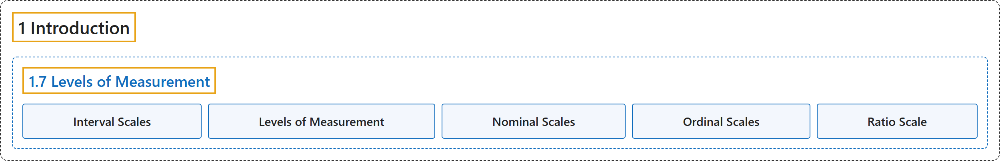

# 1.7 Levels of Measurement

## Classification

## Glossary

| Term | Definition | 中文翻译 | Source |
|---|---|---|---|
| **1.7 Levels of Measurement** 测量水平 | (No definition) | （无定义） | [Online Statistics Education, n.d., section 1.7](https://onlinestatbook.com/2/introduction/levels_of_measurement.html) |
| **Interval Scales** 定距量表 | "One of 4 Levels of Measurement, **interval scales** are **numerical scales in which intervals have the same interpretation throughout**. As an example, consider the Fahrenheit scale of temperature. The difference between 30 degrees and 40 degrees represents the same temperature difference as the difference between 80 degrees and 90 degrees. This is because each 10 degree interval has the same physical meaning (in terms of the kinetic energy. Unlike ratio scales, interval scales do not have a true zero point." | 作为 4 种测量水平之一，**定距量表**是**其间隔在整个量表中具有相同含义的数值量表**。例如，考虑华氏温标。30 度与 40 度之间的差所表示的温差，与 80 度与 90 度之间的差所表示的温差相同。这是因为每个 10 度的间隔具有相同的物理意义（就动能而言。与定比量表不同，定距量表没有真正的零点。 | [Online Statistics Education, n.d., glossary](https://onlinestatbook.com/2/glossary/Interval_scales.html) |
| **Levels of Measurement** 测量水平 | "Measurement scales differ in their **level of measurement**. There are four common levels of measurement:" | 测量量表在**测量水平**上各不相同。常见的测量水平有四种： | [Online Statistics Education, n.d., glossary](https://onlinestatbook.com/2/glossary/levels_of_measurement.html) |
| **Nominal Scales** 名义量表 | "A **nominal scale** is one of four commonly-used Levels of Measurement. No ordering is implied, and addition/subtraction and multiplication/division would be inappropriate for a variable on a nominal scale. {Female, Male} and {Buddhist, Christian, Hindu, Muslim} have no natural ordering (except alphabetic). Occasionally, numeric values are nominal: for instance, if a variable were coded as Female = 1, Male = 2, the set {1,2} is still nominal." | **名义量表**是四种常用测量水平之一。它不蕴含任何顺序，对名义量表上的变量进行加减乘除是不合适的。{女性，男性}和{佛教徒，基督徒，印度教徒，穆斯林}没有自然顺序（除字母顺序外）。有时，数值也是名义的：例如，如果把变量编码为女性 = 1，男性 = 2，则集合 {1,2} 仍然是名义的。 | [Online Statistics Education, n.d., glossary](https://onlinestatbook.com/2/glossary/nominal_scales.html) |
| **Ordinal Scales** 顺序量表 | "One of four commonly used levels of measurement, an **ordinal scale** is a set of ordered values. However, there is no set distance between scale values. For instance, for the scale: (Very Poor, Poor, Average, Good, Very Good) is an ordinal scale. You can assign numerical values to an ordinal scale: rating performance such as 1 for "Very Poor," 2 for "Poor," etc, but there is no assurance that the difference between a score of 1 and 2 means the same thing as the difference between a score of 2 and 3." | 作为四种常用测量水平之一，**顺序量表**是一组有序的值。然而，量表值之间没有固定的距离。例如，量表（很差，差，一般，好，很好）就是顺序量表。可以给顺序量表赋予数值：对表现评分，如“很差”为 1，“差”为 2，等等，但无法保证得分 1 与 2 之差和得分 2 与 3 之差意义相同。 | [Online Statistics Education, n.d., glossary](https://onlinestatbook.com/2/glossary/ordinal_scales.html) |
| **Ratio Scale** 定比量表 | "One of the four basic levels of measurement, a **ratio scale** is a **numerical scale with a true zero point and in which a given size interval has the same interpretation for the entire scale**. Weight is a ratio scale, Therefore, it is meaningful to say that a 200 pound person weighs twice as much as a 100 pound person." | 作为四种基本测量水平之一，**定比量表**是**具有真正零点，且给定大小的间隔在整个量表上具有相同含义的数值量表**。重量是定比量表，因此说一个 200 磅的人的体重是一个 100 磅的人的两倍是有意义的。 | [Online Statistics Education, n.d., glossary](https://onlinestatbook.com/2/glossary/ratio_scale.html) |

## References

*Online statistics education: An interactive multimedia course of study*. (n.d.). Rice University, University of Houston Clear Lake, and Tufts University. Retrieved October 29, 2026, from <https://onlinestatbook.com/2/>
