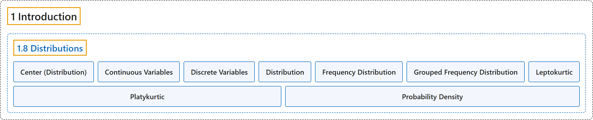

# 1.8 Distributions

## Classification

## Glossary

| Term | Definition | 中文翻译 | Source |
|---|---|---|---|
| **1.8 Distributions** 分布 | (No definition) | （无定义） | [Online Statistics Education, n.d., section 1.8](https://onlinestatbook.com/2/introduction/distributions.html) |
| **Center (Distribution)** 分布的中心 | "The **center** or middle of a distribution. There are many measures of central tendency. The most common are the mean, median, and, mode. Others include the trimean, trimmed mean, and geometric mean.)" | 分布的**中心**或中间。集中趋势的度量有很多种。最常见的是均值、中位数和众数。其他还包括三均值、截尾均值和几何平均数。） | [Online Statistics Education, n.d., glossary](https://onlinestatbook.com/2/glossary/center(distribution).html) |
| **Continuous Variables** 连续变量 | "Variables that **can take on any value in a certain range**. Time and distance are continuous; gender, SAT score and “time rounded to the nearest second” are not. Variables that are not continuous are known as **discrete variables**. No measured variable is truly continuous; however, discrete variables measured with enough precision can often be considered continuous for practical purposes." | **在一定范围内可取任意值**的变量。时间和距离是连续的；性别、SAT 分数和“四舍五入到最近一秒的时间”则不是。不连续的变量称为**离散变量**。没有任何测得的变量是真正连续的；然而，以足够精度测量的离散变量在实际应用中常可视为连续变量。 | [Online Statistics Education, n.d., glossary](https://onlinestatbook.com/2/glossary/continuous_variables.html) |
| **Discrete Variables** 离散变量 | "Variables that **can only take on a finite number of values** are called "**discrete variables**." All qualitative variables are discrete. Some quantitative variables are discrete, such as performance rated as 1,2,3,4, or 5, or temperature rounded to the nearest degree. Sometimes, a variable that takes on enough discrete values can be considered to be continuous for practical purposes. One example is time to the nearest millisecond. Variables that can take on an infinite number of possible values are called " continuous variables."" | **只能取有限个值**的变量称为“**离散变量**”。所有定性变量都是离散的。一些定量变量也是离散的，例如评为 1、2、3、4 或 5 的表现，或四舍五入到最近一度的温度。有时，取足够多离散值的变量在实际应用中可被视为连续变量。一个例子是精确到毫秒的时间。可取无限多个可能值的变量称为“连续变量”。 | [Online Statistics Education, n.d., glossary](https://onlinestatbook.com/2/glossary/discrete_variables.html) |
| **Distribution** 分布 | "The **distribution** of empirical data is called a **frequency distribution** and consists of a count of the number of occurrences of each value. If the data are continuous, then a grouped frequency distribution is used. Typically, a distribution is portrayed using a frequency polygon or a histogram." | 经验数据的**分布**称为**频数分布**，由每个值出现次数的计数构成。如果数据是连续的，则使用分组频数分布。通常，分布用频数多边形或直方图来表示。 | [Online Statistics Education, n.d., glossary](https://onlinestatbook.com/2/glossary/distribution.html) |
| **Frequency Distribution** 频数分布 | "For a discrete variable, a **frequency distribution** consists of the distribution of the number of occurrences for each value of the variable. For a continuous variable, it is the number of occurrences for a variety of ranges of variables. See also: relative frequency distribution, frequency table, frequency polygon." | 对于离散变量，**频数分布**由变量每个取值出现次数的分布构成。对于连续变量，它是变量各个取值范围的出现次数。另见：相对频数分布、频数表、频数多边形。 | [Online Statistics Education, n.d., glossary](https://onlinestatbook.com/2/glossary/frequency_dist.html) |
| **Grouped Frequency Distribution** 分组频数分布 | "A **grouped frequency distribution** is a **frequency distribution in which frequencies are displayed for ranges of data rather than for individual values**. For example, the distribution of heights might be calculated by defining one-inch ranges. The frequency of individuals with various heights rounded off to the nearest inch would then be tabulated. See also: histogram." | **分组频数分布**是**按数据范围而非单个值显示频数的频数分布**。例如，可以通过定义一英寸的范围来计算身高的分布，然后列出身高四舍五入到最近一英寸的各类个体的频数。另见：直方图。 | [Online Statistics Education, n.d., glossary](https://onlinestatbook.com/2/glossary/grouped_frequncey_distn.html) |
| **Leptokurtic** 尖峰态 | "A distribution with **long tails relative to a normal distribution** is **leptokurtic**. See also kurtosis." | 相对于正态分布具有**长尾**的分布是**尖峰态**的。另见峰度。 | [Online Statistics Education, n.d., glossary](https://onlinestatbook.com/2/glossary/leptokurtic.html) |
| **Platykurtic** 低峰态 | "A distribution with **short tails relative to a normal distribution** is **platykurtic**. See also kurtosis." | 相对于正态分布**尾部较短**的分布是**低峰态**的。另见峰度。 | [Online Statistics Education, n.d., glossary](https://onlinestatbook.com/2/glossary/platykurtic.html) |
| **Probability Density** 概率密度 | "For a discrete random variable, a probability distribution contains the probability of each possible outcome. However, for a continuous random variable, the probability of any one outcome is zero (if you specify it to enough decimal places). A **probability density function** is a **formula that can be used to compute probabilities of a range of outcomes for a continuous random variable**. The sum of all densities is always 1.0 and the value of the function is always greater or equal to zero." | 对于离散随机变量，概率分布包含每个可能结果的概率。然而，对于连续随机变量，任何单一结果的概率都为零（如果将其精确到足够多的小数位）。**概率密度函数**是**可用于计算连续随机变量某一范围结果的概率的公式**。所有密度之和始终为 1.0，且该函数的值始终大于或等于零。 | [Online Statistics Education, n.d., glossary](https://onlinestatbook.com/2/glossary/probability_density.html) |

## References

*Online statistics education: An interactive multimedia course of study*. (n.d.). Rice University, University of Houston Clear Lake, and Tufts University. Retrieved October 29, 2026, from <https://onlinestatbook.com/2/>
