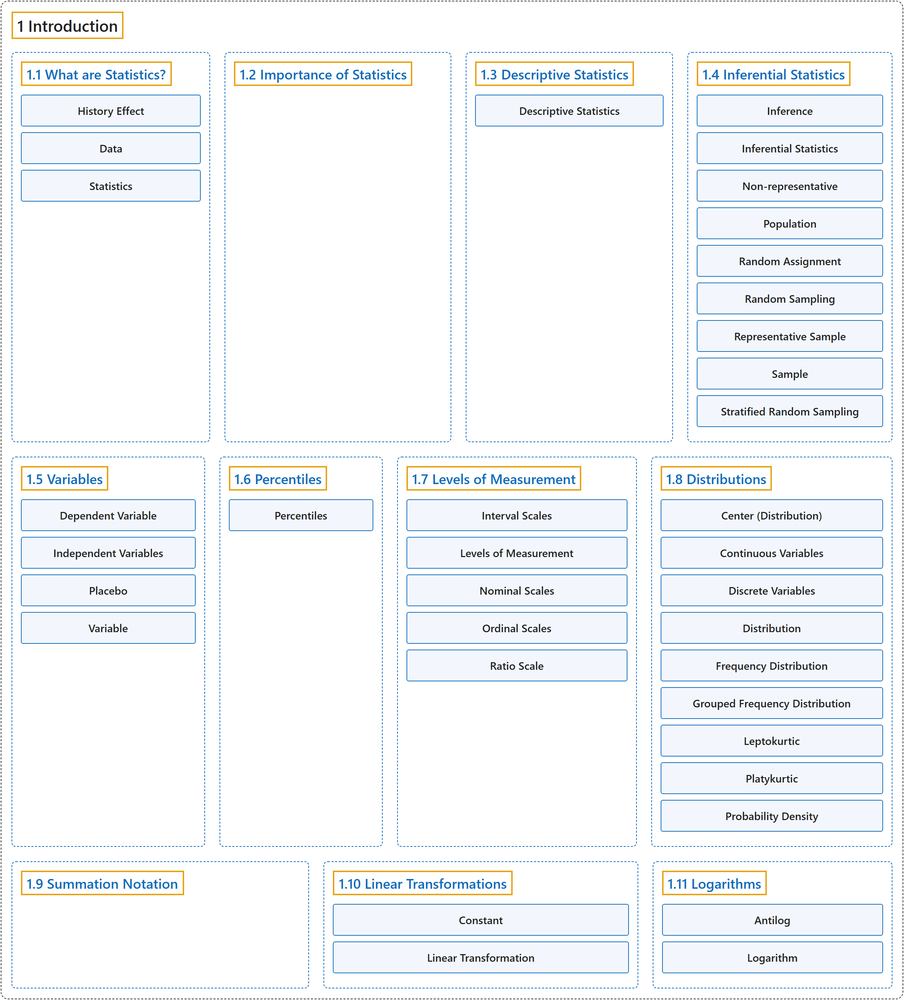

# 1 Introduction

## Classification

## Glossary

| Term | Definition | 中文翻译 | Source |
|---|---|---|---|
| **1 Introduction** 介绍 | (No definition) | （无定义） | [Online Statistics Education, n.d., chapter 1](https://onlinestatbook.com/2/introduction/introduction.html) |
| **[1.1 What are Statistics?](1-1-what-are-statistics.md)** 什么是统计学 | (No definition) | （无定义） | [Online Statistics Education, n.d., section 1.1](https://onlinestatbook.com/2/introduction/what_are.html) |
| **[1.2 Importance of Statistics](1-2-importance-of-statistics.md)** 统计的重要性 | (No definition) | （无定义） | [Online Statistics Education, n.d., section 1.2](https://onlinestatbook.com/2/introduction/importance.html) |
| **[1.3 Descriptive Statistics](1-3-descriptive-statistics.md)** 描述统计 | (No definition) | （无定义） | [Online Statistics Education, n.d., section 1.3](https://onlinestatbook.com/2/introduction/descriptive.html) |
| **[1.4 Inferential Statistics](1-4-inferential-statistics.md)** 推断统计 | (No definition) | （无定义） | [Online Statistics Education, n.d., section 1.4](https://onlinestatbook.com/2/introduction/inferential.html) |
| **[1.5 Variables](1-5-variables.md)** 变量 | (No definition) | （无定义） | [Online Statistics Education, n.d., section 1.5](https://onlinestatbook.com/2/introduction/variables.html) |
| **[1.6 Percentiles](1-6-percentiles.md)** 百分位数 | (No definition) | （无定义） | [Online Statistics Education, n.d., section 1.6](https://onlinestatbook.com/2/introduction/percentiles.html) |
| **[1.7 Levels of Measurement](1-7-levels-of-measurement.md)** 测量水平 | (No definition) | （无定义） | [Online Statistics Education, n.d., section 1.7](https://onlinestatbook.com/2/introduction/levels_of_measurement.html) |
| **[1.8 Distributions](1-8-distributions.md)** 分布 | (No definition) | （无定义） | [Online Statistics Education, n.d., section 1.8](https://onlinestatbook.com/2/introduction/distributions.html) |
| **[1.9 Summation Notation](1-9-summation-notation.md)** 求和记号 | (No definition) | （无定义） | [Online Statistics Education, n.d., section 1.9](https://onlinestatbook.com/2/introduction/summation.html) |
| **[1.10 Linear Transformations](1-10-linear-transformations.md)** 线性变换 | (No definition) | （无定义） | [Online Statistics Education, n.d., section 1.10](https://onlinestatbook.com/2/introduction/linear_transforms.html) |
| **[1.11 Logarithms](1-11-logarithms.md)** 对数 | (No definition) | （无定义） | [Online Statistics Education, n.d., section 1.11](https://onlinestatbook.com/2/introduction/logarithms.html) |

## References

*Online statistics education: An interactive multimedia course of study*. (n.d.). Rice University, University of Houston Clear Lake, and Tufts University. Retrieved October 29, 2026, from <https://onlinestatbook.com/2/>
