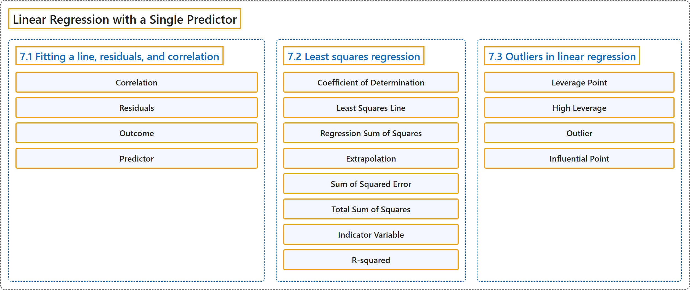

# 7 Linear Regression with a Single Predictor

## Classification

## Glossary

| Term | Definition | 中文翻译 | Source |
|---|---|---|---|
| **7 Linear Regression with a Single Predictor** 单预测变量线性回归 | (No definition) | （无定义） | [Çetinkaya-Rundel & Hardin, 2024, chapter 7](https://openintro-ims.netlify.app/model-slr.html) |
| **7.1 Fitting a line, residuals, and correlation** 直线拟合、残差与相关 | (No definition) | （无定义） | [Çetinkaya-Rundel & Hardin, 2024, section 7.1](https://openintro-ims.netlify.app/model-slr.html#sec-fit-line-res-cor) |
| **Correlation** 相关系数 | "**Correlation** which always takes values between -1 and 1, describes the **strength and direction of the linear relationship** between two variables." | **相关系数**的取值总是在 -1 和 1 之间，描述两个变量之间线性关系的**强度和方向**。 | [Çetinkaya-Rundel & Hardin, 2024, section 7.1](https://openintro-ims.netlify.app/model-slr.html#:~:text=Correlation%20which%20always%20takes%20values%20between) |
| **Residuals** 残差 | "**Residuals** are the **leftover variation in the data** after accounting for the model fit:" | **残差**是考虑模型拟合之后数据中**剩余的变异**： | [Çetinkaya-Rundel & Hardin, 2024, section 7.1](https://openintro-ims.netlify.app/model-slr.html#:~:text=Residuals%20are%20the%20leftover%20variation%20in) |
| **Outcome** 结果变量 | "When we use $x$ to predict $y,$ we usually call $x$ the predictor variable and we call $y$ the **outcome**." | 当我们用 $x$ 预测 $y,$ 时，通常称 $x$ 为预测变量，称 $y$ 为**结果变量**。 | [Çetinkaya-Rundel & Hardin, 2024, section 7.1](https://openintro-ims.netlify.app/model-slr.html#:~:text=When%20we%20use%20to%20predict%20we) |
| **Predictor** 预测变量 | "When we use $x$ to predict $y,$ we usually call $x$ the **predictor variable** and we call $y$ the outcome." | 当我们用 $x$ 预测 $y,$ 时，通常称 $x$ 为**预测变量**，称 $y$ 为结果变量。 | [Çetinkaya-Rundel & Hardin, 2024, section 7.1](https://openintro-ims.netlify.app/model-slr.html#:~:text=When%20we%20use%20to%20predict%20we) |
| **7.2 Least squares regression** 最小二乘回归 | (No definition) | （无定义） | [Çetinkaya-Rundel & Hardin, 2024, section 7.2](https://openintro-ims.netlify.app/model-slr.html#sec-least-squares-regression) |
| **Coefficient of Determination** 决定系数 | "$R^2$ is also called the **coefficient of determination**." | $R^2$ 也称为**决定系数**。 | [Çetinkaya-Rundel & Hardin, 2024, section 7.2](https://openintro-ims.netlify.app/model-slr.html#:~:text=is%20also%20called%20the%20coefficient%20of) |
| **Least Squares Line** 最小二乘线 | "The line that minimizes this least squares criterion is represented as the solid line in Figure 7.14 and is commonly called the **least squares line**." | 使这一最小二乘准则最小的直线在图7.14中以实线表示，通常称为**最小二乘线**。 | [Çetinkaya-Rundel & Hardin, 2024, section 7.2](https://openintro-ims.netlify.app/model-slr.html#:~:text=The%20line%20that%20minimizes%20this%20least) |
| **Regression Sum of Squares** 回归平方和 | "The difference $SST - SSE$ is called the **regression sum of squares**, $SSR,$ and can also be calculated as $SSR = (\hat{y}_1 - \bar{y})^2 + (\hat{y}_2 - \bar{y})^2 + \cdots + (\hat{y}_n - \bar{y})^2.$" | 差值 $SST - SSE$ 称为**回归平方和**，记作 $SSR,$ 也可以按 $SSR = (\hat{y}_1 - \bar{y})^2 + (\hat{y}_2 - \bar{y})^2 + \cdots + (\hat{y}_n - \bar{y})^2.$ 计算。 | [Çetinkaya-Rundel & Hardin, 2024, section 7.2](https://openintro-ims.netlify.app/model-slr.html#:~:text=The%20difference%20is%20called%20the%20regression) |
| **Extrapolation** 外推 | "Applying a model estimate to **values outside of the realm of the original data** is called **extrapolation**." | 将模型估计应用于**原始数据范围之外的取值**称为**外推**。 | [Çetinkaya-Rundel & Hardin, 2024, section 7.2](https://openintro-ims.netlify.app/model-slr.html#:~:text=Applying%20a%20model%20estimate%20to%20values) |
| **Sum of Squared Error** 误差平方和 | "Left-over variability in the $y$ values if we know $x$ can be measured by the **sum of squared errors**, or **sum of squared residuals**, calculated using the formula below, where $\hat{y}_i$ represents the predicted value of $y_i$ based on the least squares regression." | 已知 $x$ 之后 $y$ 值中剩余的变异性可以用**误差平方和**（或**残差平方和**）来度量，其计算公式如下，其中 $\hat{y}_i$ 表示基于最小二乘回归得到的 $y_i$ 的预测值。 | [Çetinkaya-Rundel & Hardin, 2024, section 7.2](https://openintro-ims.netlify.app/model-slr.html#:~:text=Left-over%20variability%20in%20the%20values%20if) |
| **Total Sum of Squares** 总平方和 | "We define this value as the **total sum of squares**, calculated using the formula below, where $y_i$ represents each $y$ value in the sample, and $\bar{y}$ represents the mean of the $y$ values in the sample." | 我们把这个值定义为**总平方和**，按下面的公式计算，其中 $y_i$ 表示样本中的每个 $y$ 值，$\bar{y}$ 表示样本中 $y$ 值的均值。 | [Çetinkaya-Rundel & Hardin, 2024, section 7.2](https://openintro-ims.netlify.app/model-slr.html#:~:text=We%20define%20this%20value%20as%20the) |
| **Indicator Variable** 指示变量 | "We will do so using an **indicator variable** called condnew, which **takes value 1 when the game is new and 0 when the game is used**." | 我们将使用名为 condnew 的**指示变量**，它**在游戏为新时取值1，在游戏为旧时取值0**。 | [Çetinkaya-Rundel & Hardin, 2024, section 7.2](https://openintro-ims.netlify.app/model-slr.html#:~:text=We%20will%20do%20so%20using%20an) |
| **R-squared** R方 | "However, it is more common to explain the strength of a linear fit using $R^2,$ called **R-squared**." | 然而，更常用 $R^2,$ 来解释线性拟合的强度，称为**R方**（R-squared）。 | [Çetinkaya-Rundel & Hardin, 2024, section 7.2](https://openintro-ims.netlify.app/model-slr.html#:~:text=However%2C%20it%20is%20more%20common%20to) |
| **7.3 Outliers in linear regression** 线性回归中的异常值 | (No definition) | （无定义） | [Çetinkaya-Rundel & Hardin, 2024, section 7.3](https://openintro-ims.netlify.app/model-slr.html#sec-outliers-in-regression) |
| **Leverage Point** 杠杆点 | "Points that fall horizontally away from the center of the cloud tend to pull harder on the line, so we call them points with high leverage or **leverage points**." | 水平方向上远离点云中心的点往往对直线的拉力更大，因此我们称之为高杠杆点或**杠杆点**。 | [Çetinkaya-Rundel & Hardin, 2024, section 7.3](https://openintro-ims.netlify.app/model-slr.html#:~:text=Points%20that%20fall%20horizontally%20away%20from) |
| **High Leverage** 高杠杆 | "Points that fall horizontally away from the center of the cloud tend to pull harder on the line, so we call them points with **high leverage** or leverage points." | 水平方向上远离点云中心的点往往对直线的拉力更大，因此我们称之为具有**高杠杆**的点或杠杆点。 | [Çetinkaya-Rundel & Hardin, 2024, section 7.3](https://openintro-ims.netlify.app/model-slr.html#:~:text=Points%20that%20fall%20horizontally%20away%20from) |
| **Outlier** 离群值 | "A point (or a group of points) that **stands out from the rest of the data** is called an **outlier**. Outliers that fall horizontally away from the center of the cloud of points are called leverage points." | 与其余数据**明显不同**的一个点（或一组点）称为**离群值**。水平方向上远离点云中心的离群值称为杠杆点。 | [Çetinkaya-Rundel & Hardin, 2024, section 7.3](https://openintro-ims.netlify.app/model-slr.html#:~:text=A%20point%20%28or%20a%20group%20of) |
| **Influential Point** 强影响点 | "If one of these high leverage points does appear to actually invoke its influence on the slope of the line – as in Plots C, D, and E of Figure 7.16 (a) and Figure 7.16 (b) – then we call it an **influential point**." | 如果这些高杠杆点中的某一个确实对直线的斜率产生了影响，如图7.16（a）和图7.16（b）的图 C、D、E 所示，那么我们称之为**强影响点**。 | [Çetinkaya-Rundel & Hardin, 2024, section 7.3](https://openintro-ims.netlify.app/model-slr.html#:~:text=If%20one%20of%20these%20high%20leverage) |

## References

Çetinkaya-Rundel, M., & Hardin, J. (2024). *Introduction to modern statistics* (2nd ed.). OpenIntro. Retrieved October 28, 2026, from <https://openintro-ims.netlify.app/>
