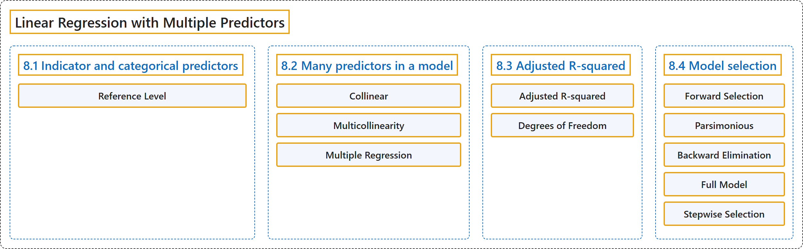

# 8 Linear Regression with Multiple Predictors

## Classification

## Glossary

| Term | Definition | 中文翻译 | Source |
|---|---|---|---|
| **8 Linear Regression with Multiple Predictors** 多预测变量线性回归 | (No definition) | （无定义） | [Çetinkaya-Rundel & Hardin, 2024, chapter 8](https://openintro-ims.netlify.app/model-mlr.html) |
| **8.1 Indicator and categorical predictors** 指示变量与分类预测变量 | (No definition) | （无定义） | [Çetinkaya-Rundel & Hardin, 2024, section 8.1](https://openintro-ims.netlify.app/model-mlr.html#sec-ind-and-cat-predictors) |
| **Reference Level** 参照水平 | "The missing level is called the **reference level** and it represents the **default level** that other levels are measured against." | 缺失的水平称为**参照水平**，它表示其他水平与之比较的**默认水平**。 | [Çetinkaya-Rundel & Hardin, 2024, section 8.1](https://openintro-ims.netlify.app/model-mlr.html#:~:text=The%20missing%20level%20is%20called%20the) |
| **8.2 Many predictors in a model** 模型中的多个预测变量 | (No definition) | （无定义） | [Çetinkaya-Rundel & Hardin, 2024, section 8.2](https://openintro-ims.netlify.app/model-mlr.html#many-predictors-in-a-model) |
| **Collinear** 共线 | "We say the two predictor variables are **collinear** (pronounced as co-linear) **when they are correlated**, and this multicollinearity complicates model estimation." | 当两个预测变量**相关**时，我们称它们是**共线**的（读作 co-linear），这种多重共线性会使模型估计变得复杂。 | [Çetinkaya-Rundel & Hardin, 2024, section 8.2](https://openintro-ims.netlify.app/model-mlr.html#:~:text=We%20say%20the%20two%20predictor%20variables) |
| **Multicollinearity** 多重共线性 | "We say the two predictor variables are collinear (pronounced as co-linear) when they are correlated, and this **multicollinearity** complicates model estimation." | 当两个预测变量相关时，我们称它们是共线的（读作 co-linear），这种**多重共线性**会使模型估计变得复杂。 | [Çetinkaya-Rundel & Hardin, 2024, section 8.2](https://openintro-ims.netlify.app/model-mlr.html#:~:text=We%20say%20the%20two%20predictor%20variables) |
| **Multiple Regression** 多元回归 | "For example, we might like to use the full context of borrowers to **predict the interest rate** they receive rather than using a single variable. This is the strategy used in **multiple regression**." | 例如，我们可能希望利用借款人的全部背景来**预测**他们获得的利率，而不是只使用单个变量。这就是**多元回归**所采用的策略。 | [Çetinkaya-Rundel & Hardin, 2024, section 8.2](https://openintro-ims.netlify.app/model-mlr.html#:~:text=For%20example%2C%20we%20might%20like%20to) |
| **8.3 Adjusted R-squared** 调整R方 | (No definition) | （无定义） | [Çetinkaya-Rundel & Hardin, 2024, section 8.3](https://openintro-ims.netlify.app/model-mlr.html#adjusted-r-squared) |
| **Adjusted R-squared** 调整R方 | "The **adjusted R-squared** is computed as" | **调整R方**的计算方式如下： | [Çetinkaya-Rundel & Hardin, 2024, section 8.3](https://openintro-ims.netlify.app/model-mlr.html#:~:text=The%20adjusted%20R-squared%20is%20computed%20as) |
| **Degrees of Freedom** 自由度 | "The reasoning behind the adjusted $R^2$ lies in the **degrees of freedom** associated with each variance, which is equal to $n - k - 1$ in the multiple regression context." | 调整 $R^2$ 的道理在于与每个方差相关的**自由度**，在多元回归中它等于 $n - k - 1.$ | [Çetinkaya-Rundel & Hardin, 2024, section 8.3](https://openintro-ims.netlify.app/model-mlr.html#:~:text=The%20reasoning%20behind%20the%20adjusted%20lies) |
| **8.4 Model selection** 模型选择 | (No definition) | （无定义） | [Çetinkaya-Rundel & Hardin, 2024, section 8.4](https://openintro-ims.netlify.app/model-mlr.html#sec-model-selection) |
| **Forward Selection** 前向选择 | "**Forward selection** is the reverse of the backward elimination technique. Instead, of eliminating predictors one-at-a-time, we **add predictors one-at-a-time** until we cannot find any predictors that improve the model any further." | **前向选择**与后向剔除技术相反。它不是逐个剔除预测变量，而是**逐个加入预测变量**，直到找不到任何能进一步改进模型的预测变量为止。 | [Çetinkaya-Rundel & Hardin, 2024, section 8.4](https://openintro-ims.netlify.app/model-mlr.html#:~:text=Forward%20selection%20is%20the%20reverse%20of) |
| **Parsimonious** 简约 | "It’s common (and hip, at least in the statistical world) to refer to models that have undergone such predictor pruning as **parsimonious**." | （至少在统计学界）人们通常把经过这种预测变量精简的模型称为**简约**模型。 | [Çetinkaya-Rundel & Hardin, 2024, section 8.4](https://openintro-ims.netlify.app/model-mlr.html#:~:text=It%E2%80%99s%20common%20%28and%20hip%2C%20at%20least) |
| **Backward Elimination** 后向剔除 | "**Backward elimination** starts with the full model – the model that includes all potential predictor variables. Predictors are **eliminated one-at-a-time** from the model until we cannot improve the model any further." | **后向剔除**从包含所有潜在预测变量的完整模型出发，**逐个剔除**预测变量，直到无法进一步改进模型为止。 | [Çetinkaya-Rundel & Hardin, 2024, section 8.4](https://openintro-ims.netlify.app/model-mlr.html#:~:text=Backward%20elimination%20starts%20with%20the%20full) |
| **Full Model** 完整模型 | "In practice, the **model that includes all available predictors** is often referred to as the **full model**." | 在实践中，**包含所有可用预测变量的模型**常被称为**完整模型**。 | [Çetinkaya-Rundel & Hardin, 2024, section 8.4](https://openintro-ims.netlify.app/model-mlr.html#:~:text=In%20practice%2C%20the%20model%20that%20includes) |
| **Stepwise Selection** 逐步选择 | "Two common strategies for adding or removing predictors in a multiple regression model are called backward elimination and forward selection. These techniques are often referred to as **stepwise selection strategies**, because they add or delete one variable at a time as they “step” through the candidate predictors." | 在多元回归模型中增加或删除预测变量的两种常用策略称为后向剔除和前向选择。这些技术常被称为**逐步选择策略**，因为它们在候选预测变量中“逐步”推进，每次增加或删除一个变量。 | [Çetinkaya-Rundel & Hardin, 2024, section 8.4](https://openintro-ims.netlify.app/model-mlr.html#:~:text=Two%20common%20strategies%20for%20adding%20or) |

## References

Çetinkaya-Rundel, M., & Hardin, J. (2024). *Introduction to modern statistics* (2nd ed.). OpenIntro. Retrieved October 28, 2026, from <https://openintro-ims.netlify.app/>
