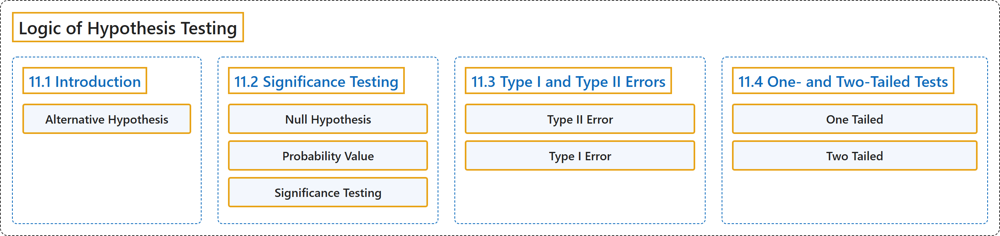

# 11 Logic of Hypothesis Testing

## Classification

## Glossary

| Term | Definition | 中文翻译 | Source |
|---|---|---|---|
| **11 Logic of Hypothesis Testing** 假设检验的逻辑 | (No definition) | （无定义） | [Online Statistics Education, n.d., chapter 11](https://onlinestatbook.com/2/logic_of_hypothesis_testing/logic_hypothesis.html) |
| **11.1 Introduction** 引言 | (No definition) | （无定义） | [Online Statistics Education, n.d., section 11.1](https://onlinestatbook.com/2/logic_of_hypothesis_testing/intro.html) |
| **Alternative Hypothesis** 备择假设 | "In hypothesis testing, the null hypothesis and an alternative hypothesis are put forward. If the data are sufficiently strong to reject the null hypothesis, then the null hypothesis is rejected in favor of an **alternative hypothesis**. For instance, if the null hypothesis were that $\mu_1 = \mu_2$ then the alternative hypothesis (for a two-tailed test) would be $\mu_1 \neq \mu_2$." | 在假设检验中，会提出零假设和一个备择假设。如果数据足够有力，能够拒绝零假设，则拒绝零假设而接受一个**备择假设**。例如，若零假设为 $\mu_1 = \mu_2$，则（双尾检验的）备择假设为 $\mu_1 \neq \mu_2$。 | [Online Statistics Education, n.d., glossary](https://onlinestatbook.com/2/glossary/alternative_hypothesis.html) |
| **11.2 Significance Testing** 显著性检验 | (No definition) | （无定义） | [Online Statistics Education, n.d., section 11.2](https://onlinestatbook.com/2/logic_of_hypothesis_testing/significance.html) |
| **Null Hypothesis** 零假设 | "A **null hypothesis** is a hypothesis tested in significance testing. It is typically **the hypothesis that a parameter is zero or that a difference between parameters is zero**. For example, the null hypothesis might be that the difference between population means is zero. Experimenters typically design experiments to allow the null hypothesis to be rejected." | **零假设**是在显著性检验中被检验的假设。它通常是**认为某个参数为零或参数之间的差为零的假设**。例如，零假设可能是总体均值之差为零。实验者通常设计实验以便能够拒绝零假设。 | [Online Statistics Education, n.d., glossary](https://onlinestatbook.com/2/glossary/null_hypothesis.html) |
| **Probability Value** 概率值 | "In significance testing, the **probability value** (sometimes called the $p$ value) is the **probability of obtaining a statistic as different or more different from the parameter specified in the null hypothesis as the statistic obtained in the experiment**. The probability value is computed assuming the null hypothesis is true. The lower the probability value, the stronger the evidence that the null hypothesis is false. Traditionally, the null hypothesis is rejected if the probability value is below 0.05. Probability values can be either one tailed or two tailed." | 在显著性检验中，**概率值**（有时称为 $p$ 值）是**获得与零假设所指定的参数的差异达到或超过实验所得统计量的差异的统计量的概率**。概率值是在假定零假设为真的前提下计算的。概率值越低，零假设为假的证据就越强。传统上，如果概率值低于 0.05，则拒绝零假设。概率值可以是单尾的，也可以是双尾的。 | [Online Statistics Education, n.d., glossary](https://onlinestatbook.com/2/glossary/probability_value.html) |
| **Significance Testing** 显著性检验 | "A statistical procedure that **tests the viability of the null hypothesis**. If data (or more extreme data) are very unlikely given that the null hypothesis is true, then the null hypothesis is rejected. If the data or more extreme data are not unlikely, then the null hypothesis is not rejected. If the null hypothesis is rejected, then the result of the test is said to be significant. A statistically significant effect does not mean the effect is important." | 一种**检验零假设可行性**的统计程序。如果在零假设为真的前提下，这些数据（或更极端的数据）非常不可能出现，则拒绝零假设。如果这些数据或更极端的数据并非不可能出现，则不拒绝零假设。如果零假设被拒绝，则称检验结果是显著的。统计上显著的效应并不意味着该效应是重要的。 | [Online Statistics Education, n.d., glossary](https://onlinestatbook.com/2/glossary/significance_testing.html) |
| **11.3 Type I and Type II Errors** 第一类错误与第二类错误 | (No definition) | （无定义） | [Online Statistics Education, n.d., section 11.3](https://onlinestatbook.com/2/logic_of_hypothesis_testing/errors.html) |
| **Type II Error** 第二类错误 | "In significance testing, the **failure to reject a false null hypothesis**." | 在显著性检验中，**未能拒绝一个错误的零假设**。 | [Online Statistics Education, n.d., glossary](https://onlinestatbook.com/2/glossary/type_II_error.html) |
| **Type I Error** 第一类错误 | "In significance testing, the error of **rejecting a true null hypothesis**." | 在显著性检验中，**拒绝真零假设**的错误。 | [Online Statistics Education, n.d., glossary](https://onlinestatbook.com/2/glossary/type_I_error.html) |
| **11.4 One- and Two-Tailed Tests** 单尾检验与双尾检验 | (No definition) | （无定义） | [Online Statistics Education, n.d., section 11.4](https://onlinestatbook.com/2/logic_of_hypothesis_testing/tails.html) |
| **One Tailed** 单尾 | "The last step in significance testing involves calculating the probability that a statistic would differ as much or more from the parameter specified in the null hypothesis as does the statistics obtained in the experiment. A probability computed considering differences in only one direction, such as the statistic is larger than the parameter, is called a **one-tailed probability**. For example, if a parameter is 0 and the statistic is 12, a one-tailed probability (the positive tail) would be the probability of a statistic being $\geq$ to 12. Compare with the two-tailed probability which would be the probability of being either $\leq -12$ or $\geq 12$." | 显著性检验的最后一步是计算一个统计量与零假设所指定的参数的差异达到或超过实验所得统计量的差异的概率。仅考虑一个方向上的差异（例如统计量大于参数）所计算的概率称为**单尾概率**。例如，若参数为 0，统计量为 12，则单尾概率（正尾）就是统计量 $\geq$ 12 的概率。与之对比的双尾概率是 $\leq -12$ 或 $\geq 12$ 的概率。 | [Online Statistics Education, n.d., glossary](https://onlinestatbook.com/2/glossary/one_tailed.html) |
| **Two Tailed** 双侧 | "The last step in significance testing involves calculating the probability that a statistic would differ as much or more from the parameter specified in the null hypothesis as does the statistics obtained in the experiment. A probability computed considering differences in both direction (statistic either larger or smaller than the parameter) is called **two-tailed probability**. For example, if a parameter is 0 and the statistic is 12, a two-tailed probability would be the he probability of being either $\le -12$ or $\ge 12$. Compare with the one-tailed probability which would be the probability of a statistic being $\ge$ to 12 if that were the direction specified in advance." | 显著性检验的最后一步是计算统计量与零假设中指定的参数之间的差异达到或超过实验中所得统计量的概率。考虑两个方向上的差异（统计量比参数大或小）而计算的概率称为**双侧概率**。例如，如果参数为 0，统计量为 12，则双侧概率是取值 $\le -12$ 或 $\ge 12$ 的概率。与单侧概率相比较，如果预先指定的方向是这个方向，单侧概率是统计量 $\ge$ 12 的概率。 | [Online Statistics Education, n.d., glossary](https://onlinestatbook.com/2/glossary/two_tailed.html) |

## References

*Online statistics education: An interactive multimedia course of study*. (n.d.). Rice University, University of Houston Clear Lake, and Tufts University. Retrieved October 29, 2026, from <https://onlinestatbook.com/2/>
