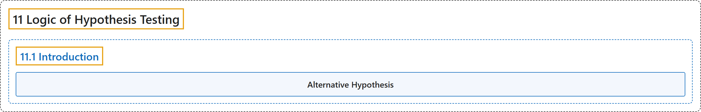

# 11.1 Introduction

## Classification

## Glossary

| Term | Definition | 中文翻译 | Source |
|---|---|---|---|
| **11.1 Introduction** 介绍 | (No definition) | （无定义） | [Online Statistics Education, n.d., section 11.1](https://onlinestatbook.com/2/logic_of_hypothesis_testing/intro.html) |
| **Alternative Hypothesis** 备择假设 | "In hypothesis testing, the null hypothesis and an alternative hypothesis are put forward. If the data are sufficiently strong to reject the null hypothesis, then the null hypothesis is rejected in favor of an **alternative hypothesis**. For instance, if the null hypothesis were that $\mu_1 = \mu_2$ then the alternative hypothesis (for a two-tailed test) would be $\mu_1 \neq \mu_2$." | 在假设检验中，会提出零假设和一个备择假设。如果数据足够有力，能够拒绝零假设，则拒绝零假设而接受一个**备择假设**。例如，若零假设为 $\mu_1 = \mu_2$，则（双尾检验的）备择假设为 $\mu_1 \neq \mu_2$。 | [Online Statistics Education, n.d., glossary](https://onlinestatbook.com/2/glossary/alternative_hypothesis.html) |

## References

*Online statistics education: An interactive multimedia course of study*. (n.d.). Rice University, University of Houston Clear Lake, and Tufts University. Retrieved October 29, 2026, from <https://onlinestatbook.com/2/>
