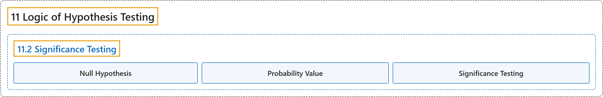

# 11.2 Significance Testing

## Classification

## Glossary

| Term | Definition | 中文翻译 | Source |
|---|---|---|---|
| **11.2 Significance Testing** 显著性检验 | (No definition) | （无定义） | [Online Statistics Education, n.d., section 11.2](https://onlinestatbook.com/2/logic_of_hypothesis_testing/significance.html) |
| **Null Hypothesis** 零假设 | "A **null hypothesis** is a hypothesis tested in significance testing. It is typically **the hypothesis that a parameter is zero or that a difference between parameters is zero**. For example, the null hypothesis might be that the difference between population means is zero. Experimenters typically design experiments to allow the null hypothesis to be rejected." | **零假设**是在显著性检验中被检验的假设。它通常是**认为某个参数为零或参数之间的差为零的假设**。例如，零假设可能是总体均值之差为零。实验者通常设计实验以便能够拒绝零假设。 | [Online Statistics Education, n.d., glossary](https://onlinestatbook.com/2/glossary/null_hypothesis.html) |
| **Probability Value** 概率值 | "In significance testing, the **probability value** (sometimes called the $p$ value) is the **probability of obtaining a statistic as different or more different from the parameter specified in the null hypothesis as the statistic obtained in the experiment**. The probability value is computed assuming the null hypothesis is true. The lower the probability value, the stronger the evidence that the null hypothesis is false. Traditionally, the null hypothesis is rejected if the probability value is below 0.05. Probability values can be either one tailed or two tailed." | 在显著性检验中，**概率值**（有时称为 $p$ 值）是**获得与零假设所指定的参数的差异达到或超过实验所得统计量的差异的统计量的概率**。概率值是在假定零假设为真的前提下计算的。概率值越低，零假设为假的证据就越强。传统上，如果概率值低于 0.05，则拒绝零假设。概率值可以是单尾的，也可以是双尾的。 | [Online Statistics Education, n.d., glossary](https://onlinestatbook.com/2/glossary/probability_value.html) |
| **Significance Testing** 显著性检验 | "A statistical procedure that **tests the viability of the null hypothesis**. If data (or more extreme data) are very unlikely given that the null hypothesis is true, then the null hypothesis is rejected. If the data or more extreme data are not unlikely, then the null hypothesis is not rejected. If the null hypothesis is rejected, then the result of the test is said to be significant. A statistically significant effect does not mean the effect is important." | 一种**检验零假设可行性**的统计程序。如果在零假设为真的前提下，这些数据（或更极端的数据）非常不可能出现，则拒绝零假设。如果这些数据或更极端的数据并非不可能出现，则不拒绝零假设。如果零假设被拒绝，则称检验结果是显著的。统计上显著的效应并不意味着该效应是重要的。 | [Online Statistics Education, n.d., glossary](https://onlinestatbook.com/2/glossary/significance_testing.html) |

## References

*Online statistics education: An interactive multimedia course of study*. (n.d.). Rice University, University of Houston Clear Lake, and Tufts University. Retrieved October 29, 2026, from <https://onlinestatbook.com/2/>
