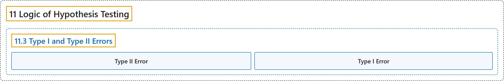

# 11.3 Type I and Type II Errors

## Classification

## Glossary

| Term | Definition | 中文翻译 | Source |
|---|---|---|---|
| **11.3 Type I and Type II Errors** 第一类错误与第二类错误 | (No definition) | （无定义） | [Online Statistics Education, n.d., section 11.3](https://onlinestatbook.com/2/logic_of_hypothesis_testing/errors.html) |
| **Type II Error** 第二类错误 | "In significance testing, the **failure to reject a false null hypothesis**." | 在显著性检验中，**未能拒绝一个错误的零假设**。 | [Online Statistics Education, n.d., glossary](https://onlinestatbook.com/2/glossary/type_II_error.html) |
| **Type I Error** 第一类错误 | "In significance testing, the error of **rejecting a true null hypothesis**." | 在显著性检验中，**拒绝真零假设**的错误。 | [Online Statistics Education, n.d., glossary](https://onlinestatbook.com/2/glossary/type_I_error.html) |

## References

*Online statistics education: An interactive multimedia course of study*. (n.d.). Rice University, University of Houston Clear Lake, and Tufts University. Retrieved October 29, 2026, from <https://onlinestatbook.com/2/>
