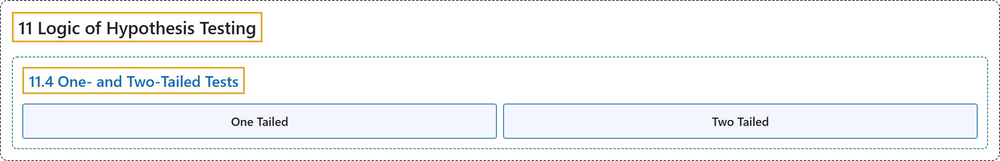

# 11.4 One- and Two-Tailed Tests

## Classification

## Glossary

| Term | Definition | 中文翻译 | Source |
|---|---|---|---|
| **11.4 One- and Two-Tailed Tests** 单尾检验与双尾检验 | (No definition) | （无定义） | [Online Statistics Education, n.d., section 11.4](https://onlinestatbook.com/2/logic_of_hypothesis_testing/tails.html) |
| **One Tailed** 单尾 | "The last step in significance testing involves calculating the probability that a statistic would differ as much or more from the parameter specified in the null hypothesis as does the statistics obtained in the experiment. A probability computed considering differences in only one direction, such as the statistic is larger than the parameter, is called a **one-tailed probability**. For example, if a parameter is 0 and the statistic is 12, a one-tailed probability (the positive tail) would be the probability of a statistic being $\geq$ to 12. Compare with the two-tailed probability which would be the probability of being either $\leq -12$ or $\geq 12$." | 显著性检验的最后一步是计算一个统计量与零假设所指定的参数的差异达到或超过实验所得统计量的差异的概率。仅考虑一个方向上的差异（例如统计量大于参数）所计算的概率称为**单尾概率**。例如，若参数为 0，统计量为 12，则单尾概率（正尾）就是统计量 $\geq$ 12 的概率。与之对比的双尾概率是 $\leq -12$ 或 $\geq 12$ 的概率。 | [Online Statistics Education, n.d., glossary](https://onlinestatbook.com/2/glossary/one_tailed.html) |
| **Two Tailed** 双侧 | "The last step in significance testing involves calculating the probability that a statistic would differ as much or more from the parameter specified in the null hypothesis as does the statistics obtained in the experiment. A probability computed considering differences in both direction (statistic either larger or smaller than the parameter) is called **two-tailed probability**. For example, if a parameter is 0 and the statistic is 12, a two-tailed probability would be the he probability of being either $\le -12$ or $\ge 12$. Compare with the one-tailed probability which would be the probability of a statistic being $\ge$ to 12 if that were the direction specified in advance." | 显著性检验的最后一步是计算统计量与零假设中指定的参数之间的差异达到或超过实验中所得统计量的概率。考虑两个方向上的差异（统计量比参数大或小）而计算的概率称为**双侧概率**。例如，如果参数为 0，统计量为 12，则双侧概率是取值 $\le -12$ 或 $\ge 12$ 的概率。与单侧概率相比较，如果预先指定的方向是这个方向，单侧概率是统计量 $\ge$ 12 的概率。 | [Online Statistics Education, n.d., glossary](https://onlinestatbook.com/2/glossary/two_tailed.html) |

## References

*Online statistics education: An interactive multimedia course of study*. (n.d.). Rice University, University of Houston Clear Lake, and Tufts University. Retrieved October 29, 2026, from <https://onlinestatbook.com/2/>
