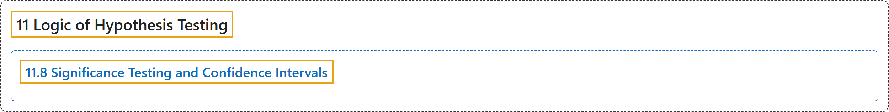

# 11.8 Significance Testing and Confidence Intervals

## Classification

## Glossary

| Term | Definition | 中文翻译 | Source |
|---|---|---|---|
| **11.8 Significance Testing and Confidence Intervals** 显著性检验与置信区间 | (No definition) | （无定义） | [Online Statistics Education, n.d., section 11.8](https://onlinestatbook.com/2/logic_of_hypothesis_testing/sign_conf.html) |

## References

*Online statistics education: An interactive multimedia course of study*. (n.d.). Rice University, University of Houston Clear Lake, and Tufts University. Retrieved October 29, 2026, from <https://onlinestatbook.com/2/>
