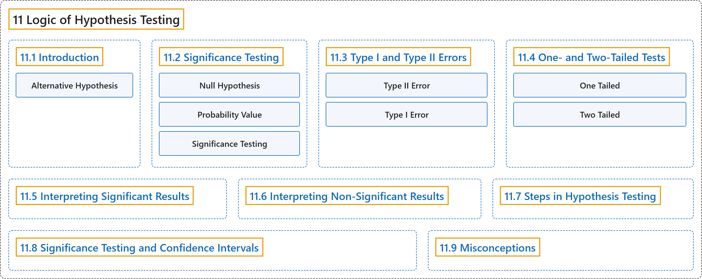

# 11 Logic of Hypothesis Testing

## Classification

## Glossary

| Term | Definition | 中文翻译 | Source |
|---|---|---|---|
| **11 Logic of Hypothesis Testing** 假设检验的逻辑 | (No definition) | （无定义） | [Online Statistics Education, n.d., chapter 11](https://onlinestatbook.com/2/logic_of_hypothesis_testing/logic_hypothesis.html) |
| **[11.1 Introduction](11-1-introduction.md)** 介绍 | (No definition) | （无定义） | [Online Statistics Education, n.d., section 11.1](https://onlinestatbook.com/2/logic_of_hypothesis_testing/intro.html) |
| **[11.2 Significance Testing](11-2-significance-testing.md)** 显著性检验 | (No definition) | （无定义） | [Online Statistics Education, n.d., section 11.2](https://onlinestatbook.com/2/logic_of_hypothesis_testing/significance.html) |
| **[11.3 Type I and Type II Errors](11-3-type-i-and-type-ii-errors.md)** 第一类错误与第二类错误 | (No definition) | （无定义） | [Online Statistics Education, n.d., section 11.3](https://onlinestatbook.com/2/logic_of_hypothesis_testing/errors.html) |
| **[11.4 One- and Two-Tailed Tests](11-4-one-and-two-tailed-tests.md)** 单尾检验与双尾检验 | (No definition) | （无定义） | [Online Statistics Education, n.d., section 11.4](https://onlinestatbook.com/2/logic_of_hypothesis_testing/tails.html) |
| **[11.5 Interpreting Significant Results](11-5-interpreting-significant-results.md)** 解读显著的结果 | (No definition) | （无定义） | [Online Statistics Education, n.d., section 11.5](https://onlinestatbook.com/2/logic_of_hypothesis_testing/significant.html) |
| **[11.6 Interpreting Non-Significant Results](11-6-interpreting-non-significant-results.md)** 解读不显著的结果 | (No definition) | （无定义） | [Online Statistics Education, n.d., section 11.6](https://onlinestatbook.com/2/logic_of_hypothesis_testing/nonsignificant.html) |
| **[11.7 Steps in Hypothesis Testing](11-7-steps-in-hypothesis-testing.md)** 假设检验的步骤 | (No definition) | （无定义） | [Online Statistics Education, n.d., section 11.7](https://onlinestatbook.com/2/logic_of_hypothesis_testing/steps.html) |
| **[11.8 Significance Testing and Confidence Intervals](11-8-significance-testing-and-confidence-intervals.md)** 显著性检验与置信区间 | (No definition) | （无定义） | [Online Statistics Education, n.d., section 11.8](https://onlinestatbook.com/2/logic_of_hypothesis_testing/sign_conf.html) |
| **[11.9 Misconceptions](11-9-misconceptions.md)** 常见误解 | (No definition) | （无定义） | [Online Statistics Education, n.d., section 11.9](https://onlinestatbook.com/2/logic_of_hypothesis_testing/misconceptions.html) |

## References

*Online statistics education: An interactive multimedia course of study*. (n.d.). Rice University, University of Houston Clear Lake, and Tufts University. Retrieved October 29, 2026, from <https://onlinestatbook.com/2/>
