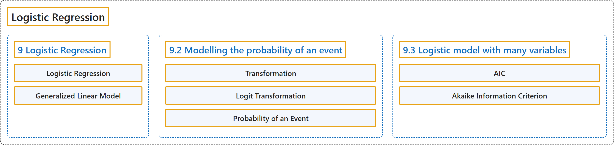

# 9 Logistic Regression

## Classification

## Glossary

| Term | Definition | 中文翻译 | Source |
|---|---|---|---|
| **9 Logistic Regression** 逻辑斯谛回归 | (No definition) | （无定义） | [Çetinkaya-Rundel & Hardin, 2024, chapter 9](https://openintro-ims.netlify.app/model-logistic.html) |
| **Logistic Regression** 逻辑回归 | "In this chapter we introduce **logistic regression** as a tool for building models when there is a **categorical response variable with two levels**, e.g., yes and no." | 本章介绍**逻辑回归**，它是在存在只有两个水平（例如“是”和“否”）的**分类响应变量**时构建模型的工具。 | [Çetinkaya-Rundel & Hardin, 2024, chapter 9 introduction](https://openintro-ims.netlify.app/model-logistic.html#:~:text=In%20this%20chapter%20we%20introduce%20logistic) |
| **Generalized Linear Model** 广义线性模型 | "Logistic regression is a type of **generalized linear model** (GLM) for response variables where regular multiple regression does not work very well. GLMs can be thought of as a **two-stage modeling approach**." | 逻辑回归是一种**广义线性模型**（GLM），适用于普通多元回归效果不太好的响应变量。GLM 可以被看作一种**两阶段建模方法**。 | [Çetinkaya-Rundel & Hardin, 2024, chapter 9 introduction](https://openintro-ims.netlify.app/model-logistic.html#:~:text=Logistic%20regression%20is%20a%20type%20of) |
| **9.2 Modelling the probability of an event** 事件概率的建模 | (No definition) | （无定义） | [Çetinkaya-Rundel & Hardin, 2024, section 9.2](https://openintro-ims.netlify.app/model-logistic.html#sec-modelingTheProbabilityOfAnEvent) |
| **Transformation** 变换 | "We want to choose a **transformation** in the equation that makes practical and mathematical sense." | 我们希望在方程中选择一种在实际和数学上都有意义的**变换**。 | [Çetinkaya-Rundel & Hardin, 2024, section 9.2](https://openintro-ims.netlify.app/model-logistic.html#:~:text=We%20want%20to%20choose%20a%20transformation) |
| **Logit Transformation** logit变换 | "A common transformation for $p_i$ is the **logit transformation**, which may be written as" | $p_i$ 的一种常用变换是**logit变换**，可以写成 | [Çetinkaya-Rundel & Hardin, 2024, section 9.2](https://openintro-ims.netlify.app/model-logistic.html#:~:text=A%20common%20transformation%20for%20is%20the) |
| **Probability of an Event** 事件概率 | "Ultimately, it is the **probability of the outcome taking the value 1** (i.e., being a “success”) that we model in relation to the predictor variables: we will examine which resume characteristics correspond to higher or lower callback rates." | 最终，我们建立模型描述的是结果取值为1（即成为“成功”）的**概率**与预测变量之间的关系：我们将考察简历的哪些特征对应更高或更低的回电率。 | [Çetinkaya-Rundel & Hardin, 2024, section 9.2](https://openintro-ims.netlify.app/model-logistic.html#:~:text=Ultimately%2C%20it%20is%20the%20probability%20of) |
| **9.3 Logistic model with many variables** 含多个变量的逻辑斯谛模型 | (No definition) | （无定义） | [Çetinkaya-Rundel & Hardin, 2024, section 9.3](https://openintro-ims.netlify.app/model-logistic.html#logistic-model-with-many-variables) |
| **AIC** 赤池信息准则 | "**AIC** is a popular model selection method used in many disciplines, and is praised for its emphasis on model uncertainty and parsimony. AIC selects a “best” model by **ranking models from best to worst** according to their AIC values." | **AIC** 是一种在许多学科中广泛使用的模型选择方法，因强调模型不确定性和简约性而备受称赞。AIC 通过按 AIC 值对模型从优到劣进行**排序**来选出“最佳”模型。 | [Çetinkaya-Rundel & Hardin, 2024, section 9.3](https://openintro-ims.netlify.app/model-logistic.html#:~:text=AIC%20is%20a%20popular%20model%20selection) |
| **Akaike Information Criterion** 赤池信息准则 | "Here we’ll use a statistic called **Akaike information criterion** (AIC), which is analogous to how we used adjusted $R^2$ in multiple regression." | 这里我们将使用一个称为**赤池信息准则**（AIC）的统计量，它类似于我们在多元回归中使用调整 $R^2$ 的方式。 | [Çetinkaya-Rundel & Hardin, 2024, section 9.3](https://openintro-ims.netlify.app/model-logistic.html#:~:text=Here%20we%E2%80%99ll%20use%20a%20statistic%20called) |

## References

Çetinkaya-Rundel, M., & Hardin, J. (2024). *Introduction to modern statistics* (2nd ed.). OpenIntro. Retrieved October 28, 2026, from <https://openintro-ims.netlify.app/>
