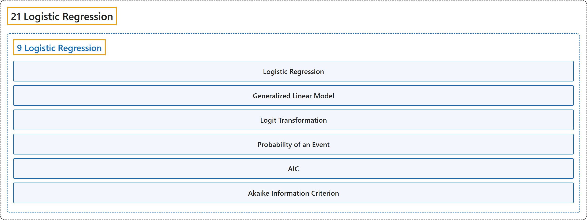

# 21 Logistic Regression

## Classification

## Glossary

| Term | Definition | 中文翻译 | Source |
|---|---|---|---|
| **21 Logistic Regression** 逻辑斯谛回归 | (No definition) | （无定义） | [Çetinkaya-Rundel & Hardin, 2024](https://openintro-ims.netlify.app/) |
| **[9 Logistic Regression](9-logistic-regression.md)** 逻辑斯谛回归 | (No definition) | （无定义） | [Çetinkaya-Rundel & Hardin, 2024, chapter 9](https://openintro-ims.netlify.app/model-logistic.html) |

## References

Çetinkaya-Rundel, M., & Hardin, J. (2024). *Introduction to modern statistics* (2nd ed.). OpenIntro. Retrieved October 28, 2026, from <https://openintro-ims.netlify.app/>
