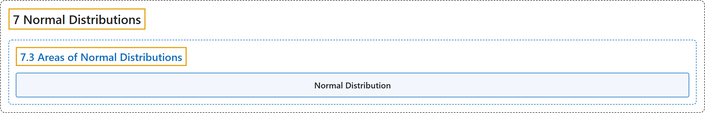

# 7.3 Areas of Normal Distributions

## Classification

## Glossary

| Term | Definition | 中文翻译 | Source |
|---|---|---|---|
| **7.3 Areas of Normal Distributions** 正态分布的面积 | (No definition) | （无定义） | [Online Statistics Education, n.d., section 7.3](https://onlinestatbook.com/2/normal_distribution/areas_normal.html) |
| **Normal Distribution** 正态分布 | "One of the most common continuous distributions, a **normal distribution** is sometimes referred to as a "bell-shaped distribution." If $\mu$ is the distribution mean, and $\sigma$ the standard deviation, then the height (ordinate) normal distribution is given by" | 作为最常见的连续分布之一，**正态分布**有时被称为“钟形分布”。如果 $\mu$ 是分布的均值，$\sigma$ 是标准差，则正态分布的高度（纵坐标）由下式给出 | [Online Statistics Education, n.d., glossary](https://onlinestatbook.com/2/glossary/normal_distribution.html) |

## References

*Online statistics education: An interactive multimedia course of study*. (n.d.). Rice University, University of Houston Clear Lake, and Tufts University. Retrieved October 29, 2026, from <https://onlinestatbook.com/2/>
