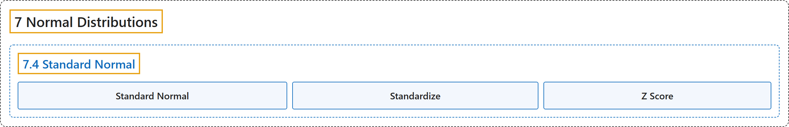

# 7.4 Standard Normal

## Classification

## Glossary

| Term | Definition | 中文翻译 | Source |
|---|---|---|---|
| **7.4 Standard Normal** 标准正态分布 | (No definition) | （无定义） | [Online Statistics Education, n.d., section 7.4](https://onlinestatbook.com/2/normal_distribution/standard_normal.html) |
| **Standard Normal** 标准正态分布 | "The **standard normal distribution** is a normal distribution with a mean of 0 and a standard deviation of 1." | **标准正态分布**是均值为 0、标准差为 1 的正态分布。 | [Online Statistics Education, n.d., glossary](https://onlinestatbook.com/2/glossary/standard_normal.html) |
| **Standardize** 标准化 | "A variable is **standardized** if it has a **mean of 0 and a standard deviation of 1**. The transformation from a raw score $X$ to a standard score can be done using the following formula:" | 如果一个变量的**均值为 0、标准差为 1**，则该变量是**标准化**的。从原始分数 $X$ 到标准分数的变换可以使用以下公式完成： | [Online Statistics Education, n.d., glossary](https://onlinestatbook.com/2/glossary/standardize.html) |
| **Z Score** Z 分数 | "The number of standard deviations a score is from the mean of its population. The term "standard score" is usually used for normal populations; the terms "**Z score**" and "normal deviate" should only be used in reference to normal distributions. The transformation from a raw score $X$ to a $Z$ score can be done using the following formula:" | 一个得分距其总体均值有多少个标准差。“标准分数”一词通常用于正态总体；“**Z 分数**”和“正态离差”这两个术语只应用于正态分布。从原始分数 $X$ 到 $Z$ 分数的变换可用下面的公式完成： | [Online Statistics Education, n.d., glossary](https://onlinestatbook.com/2/glossary/z_score.html) |

## References

*Online statistics education: An interactive multimedia course of study*. (n.d.). Rice University, University of Houston Clear Lake, and Tufts University. Retrieved October 29, 2026, from <https://onlinestatbook.com/2/>
