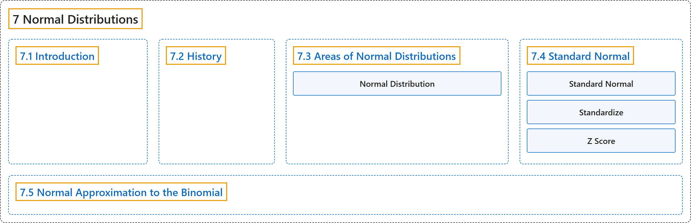

# 7 Normal Distributions

## Classification

## Glossary

| Term | Definition | 中文翻译 | Source |
|---|---|---|---|
| **7 Normal Distributions** 正态分布 | (No definition) | （无定义） | [Online Statistics Education, n.d., chapter 7](https://onlinestatbook.com/2/normal_distribution/normal_distribution.html) |
| **[7.1 Introduction](7-1-introduction.md)** 介绍 | (No definition) | （无定义） | [Online Statistics Education, n.d., section 7.1](https://onlinestatbook.com/2/normal_distribution/intro.html) |
| **[7.2 History](7-2-history.md)** 历史 | (No definition) | （无定义） | [Online Statistics Education, n.d., section 7.2](https://onlinestatbook.com/2/normal_distribution/history_normal.html) |
| **[7.3 Areas of Normal Distributions](7-3-areas-of-normal-distributions.md)** 正态分布的面积 | (No definition) | （无定义） | [Online Statistics Education, n.d., section 7.3](https://onlinestatbook.com/2/normal_distribution/areas_normal.html) |
| **[7.4 Standard Normal](7-4-standard-normal.md)** 标准正态分布 | (No definition) | （无定义） | [Online Statistics Education, n.d., section 7.4](https://onlinestatbook.com/2/normal_distribution/standard_normal.html) |
| **[7.5 Normal Approximation to the Binomial](7-5-normal-approximation-to-the-binomial.md)** 二项分布的正态近似 | (No definition) | （无定义） | [Online Statistics Education, n.d., section 7.5](https://onlinestatbook.com/2/normal_distribution/normal_approx.html) |

## References

*Online statistics education: An interactive multimedia course of study*. (n.d.). Rice University, University of Houston Clear Lake, and Tufts University. Retrieved October 29, 2026, from <https://onlinestatbook.com/2/>
