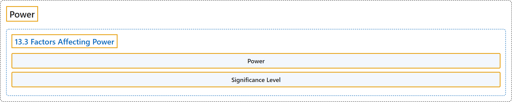

# 13 Power

## Classification

## Glossary

| Term | Definition | 中文翻译 | Source |
|---|---|---|---|
| **13 Power** 检验功效 | (No definition) | （无定义） | [Online Statistics Education, n.d., chapter 13](https://onlinestatbook.com/2/power/contents.html) |
| **13.3 Factors Affecting Power** 影响检验功效的因素 | (No definition) | （无定义） | [Online Statistics Education, n.d., section 13.3](https://onlinestatbook.com/2/power/factors.html) |
| **Power** 检验功效 | "In significance testing, **power** is the **probability of rejecting a false null hypothesis**. See also Type II error." | 在显著性检验中，**检验功效**是**拒绝一个错误的零假设的概率**。另见第二类错误。 | [Online Statistics Education, n.d., glossary](https://onlinestatbook.com/2/glossary/power.html) |
| **Significance Level** 显著性水平 | "In significance testing, the **significance level** is the highest value of a probability value for which the null hypothesis is rejected. Common significance levels are 0.05 and 0.01. If the 0.05 level is used, then the null hypothesis is rejected if the probability value is less than or equal to 0.05." | 在显著性检验中，**显著性水平**是使零假设被拒绝的概率值的最大值。常用的显著性水平为 0.05 和 0.01。如果使用 0.05 水平，则当概率值小于或等于 0.05 时拒绝零假设。 | [Online Statistics Education, n.d., glossary](https://onlinestatbook.com/2/glossary/significance_level.html) |

## References

*Online statistics education: An interactive multimedia course of study*. (n.d.). Rice University, University of Houston Clear Lake, and Tufts University. Retrieved October 29, 2026, from <https://onlinestatbook.com/2/>
