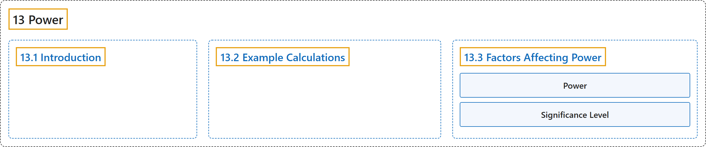

# 13 Power

## Classification

## Glossary

| Term | Definition | 中文翻译 | Source |
|---|---|---|---|
| **13 Power** 检验功效 | (No definition) | （无定义） | [Online Statistics Education, n.d., chapter 13](https://onlinestatbook.com/2/power/contents.html) |
| **[13.1 Introduction](13-1-introduction.md)** 介绍 | (No definition) | （无定义） | [Online Statistics Education, n.d., section 13.1](https://onlinestatbook.com/2/power/intro_power.html) |
| **[13.2 Example Calculations](13-2-example-calculations.md)** 计算示例 | (No definition) | （无定义） | [Online Statistics Education, n.d., section 13.2](https://onlinestatbook.com/2/power/example.html) |
| **[13.3 Factors Affecting Power](13-3-factors-affecting-power.md)** 影响检验功效的因素 | (No definition) | （无定义） | [Online Statistics Education, n.d., section 13.3](https://onlinestatbook.com/2/power/factors.html) |

## References

*Online statistics education: An interactive multimedia course of study*. (n.d.). Rice University, University of Houston Clear Lake, and Tufts University. Retrieved October 29, 2026, from <https://onlinestatbook.com/2/>
