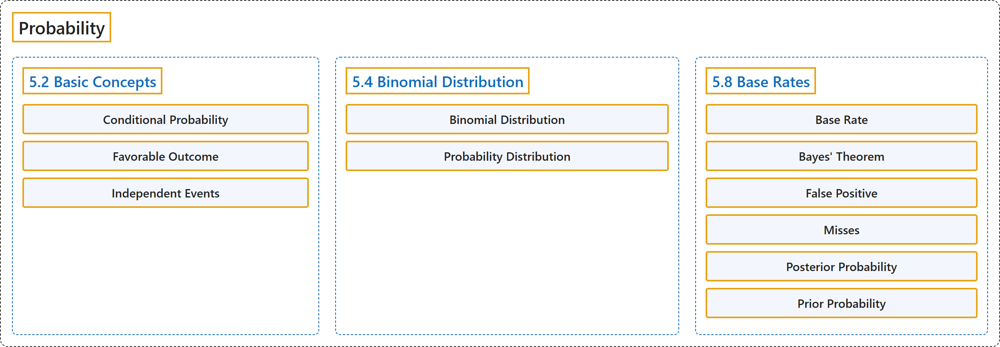

# 5 Probability

## Classification

## Glossary

| Term | Definition | 中文翻译 | Source |
|---|---|---|---|
| **5 Probability** 概率 | (No definition) | （无定义） | [Online Statistics Education, n.d., chapter 5](https://onlinestatbook.com/2/probability/probability.html) |
| **5.2 Basic Concepts** 基本概念 | (No definition) | （无定义） | [Online Statistics Education, n.d., section 5.2](https://onlinestatbook.com/2/probability/basic.html) |
| **Conditional Probability** 条件概率 | "The probability that event $A$ occurs given that event $B$ has already occurred is called the **conditional probability** of $A$ given $B$. Symbolically, this is written as $P(A \vert B)$. The probability it rains on Monday given that it rained on Sunday would be written as $P(\text{Rain on Monday} \vert \text{Rain on Sunday})$." | 在事件 $B$ 已经发生的条件下事件 $A$ 发生的概率称为给定 $B$ 时 $A$ 的**条件概率**。用符号表示为 $P(A \vert B)$。在周日下雨的条件下周一下雨的概率应写作 $P(\text{Rain on Monday} \vert \text{Rain on Sunday})$。 | [Online Statistics Education, n.d., glossary](https://onlinestatbook.com/2/glossary/conditional_p.html) |
| **Favorable Outcome** 有利结果 | "A **favorable outcome** is the outcome of interest. For example one could define a favorable outcome in the flip of a coin as a head. The term "favorable outcome" does not necessarily mean that the outcome is desirable – in some experiments, the favorable outcome could be the failure of a test, or the occurrence of an undesirable event." | **有利结果**是所关注的结果。例如，可以把抛硬币时的有利结果定义为正面。“有利结果”一词不一定意味着该结果是令人满意的——在某些实验中，有利结果可能是测试失败，或不良事件的发生。 | [Online Statistics Education, n.d., glossary](https://onlinestatbook.com/2/glossary/favorable_outcome.html) |
| **Independent Events** 独立事件 | "Events $A$ and $B$ are **independent events** if the probability of Event $B$ occurring is the same whether or not Event $A$ occurs. For example, if you throw two dice, the probability that the second die comes up 1 is independent of whether the first die came up 1. Formally, this can be stated in terms of conditional probabilities : $P(A \vert B) = P(A)$ and $P(B \vert A) = P(B)$." | 如果事件 $B$ 发生的概率无论事件 $A$ 是否发生都相同，则事件 $A$ 与 $B$ 是**独立事件**。例如，如果掷两个骰子，第二个骰子出现 1 的概率与第一个骰子是否出现 1 无关。形式上，这可以用条件概率表述为：$P(A \vert B) = P(A)$ 且 $P(B \vert A) = P(B)$。 | [Online Statistics Education, n.d., glossary](https://onlinestatbook.com/2/glossary/independent_events.html) |
| **5.4 Binomial Distribution** 二项分布 | (No definition) | （无定义） | [Online Statistics Education, n.d., section 5.4](https://onlinestatbook.com/2/probability/binomial.html) |
| **Binomial Distribution** 二项分布 | "A **probability distribution for independent events for which there are only two possible outcomes** such as a coin flip. If one of the two outcomes is defined as a success, then the probability of exactly $x$ successes out of $N$ trials (events) is given by:" | 一种**适用于只有两种可能结果的独立事件的概率分布**，例如抛硬币。如果将两种结果之一定义为成功，则在 $N$ 次试验（事件）中恰好成功 $x$ 次的概率为： | [Online Statistics Education, n.d., glossary](https://onlinestatbook.com/2/glossary/binomial_dist.html) |
| **Probability Distribution** 概率分布 | "For a discrete random variable, a **probability distribution** contains the probability of each possible outcome. The sum of all probabilities is always 1.0. See binomial distribution for an example. See also probability density function." | 对于离散随机变量，**概率分布**包含每个可能结果的概率。所有概率之和总是 1.0。示例见二项分布。另见概率密度函数。 | [Online Statistics Education, n.d., glossary](https://onlinestatbook.com/2/glossary/probability_distribution.html) |
| **5.8 Base Rates** 基础比率 | (No definition) | （无定义） | [Online Statistics Education, n.d., section 5.8](https://onlinestatbook.com/2/probability/base_rates.html) |
| **Base Rate** 基础比率 | "The **true proportion of a population** having some condition, attribute or disease. For example, the proportion of people with schizophrenia is about 0.01. It is very important to consider the base rate when classifying people. As the saying goes, "if you hear hoofs, think horse not zebra" since you are more likely to encounter a horse than a zebra (at least in most places.)" | 总体中具有某种状况、属性或疾病的**真实比例**。例如，患精神分裂症的人所占比例约为 0.01。在对人进行分类时，考虑基础比率非常重要。俗话说，“听到马蹄声，要想到马而不是斑马”，因为（至少在大多数地方）遇到马的可能性比遇到斑马更大。 | [Online Statistics Education, n.d., glossary](https://onlinestatbook.com/2/glossary/base_rate.html) |
| **Bayes' Theorem** 贝叶斯定理 | "**Bayes' theorem** considers both the prior probability of an event and the diagnostic value of a test to determine the posterior probability of the event. The theorem is shown below:" | **贝叶斯定理**同时考虑事件的先验概率和检验的诊断价值，以确定该事件的后验概率。该定理如下所示： | [Online Statistics Education, n.d., glossary](https://onlinestatbook.com/2/glossary/bayes.html) |
| **False Positive** 假阳性 | "A **false positive** occurs when **a diagnostic procedure returns a positive result while the true state of the subject is negative**. For example, if a test for strep says the patient has strep when in fact he or she does not, then the error in diagnosis would be called a false positive. In some contexts, a false positive is called a false alarm. The concept is similar to a Type I error in significance testing." | 当**诊断程序给出阳性结果而受试者的真实状态为阴性**时，就出现**假阳性**。例如，如果链球菌检测显示患者感染了链球菌，而实际上并没有，那么这种诊断错误就称为假阳性。在某些情境中，假阳性也称为假警报。这一概念类似于显著性检验中的第一类错误。 | [Online Statistics Education, n.d., glossary](https://onlinestatbook.com/2/glossary/false_positive.html) |
| **Misses** 漏报 | "**Misses** occur when a diagnostic test returns a negative result, but the true state of the subject is positive. For example, if a person has strep throat and the diagnostic test fails to indicate it, then a miss has occurred. The concept is similar to a Type II error in significance testing." | 当诊断测试返回阴性结果而受试者的真实状态为阳性时，就出现**漏报**。例如，如果一个人患有链球菌咽喉炎而诊断测试未能显示，就发生了一次漏报。这一概念类似于显著性检验中的第二类错误。 | [Online Statistics Education, n.d., glossary](https://onlinestatbook.com/2/glossary/misses.html) |
| **Posterior Probability** 后验概率 | "The **posterior probability** of an event is the probability of the event computed following the collection of new data. One begins with a prior probability of an event and revises it in the light of new data. For example, if 0.01 of a population has schizophrenia then the probability that a person drawn at random would have schizophrenia is 0.01. This is the prior probability. If you then learn that their score on a personality test suggests the person is schizophrenic, you would adjust your probability accordingly. The adjusted probability is the posterior probability." | 事件的**后验概率**是在收集新数据之后计算得到的该事件的概率。人们从事件的先验概率出发，根据新数据对其进行修正。例如，如果总体中有 0.01 的人患精神分裂症，则随机抽取的一个人患精神分裂症的概率为 0.01。这就是先验概率。如果随后得知此人在人格测验中的得分表明其患有精神分裂症，就会相应地调整概率。调整后的概率就是后验概率。 | [Online Statistics Education, n.d., glossary](https://onlinestatbook.com/2/glossary/posterior_probability.html) |
| **Prior Probability** 先验概率 | "The **prior probability** of an event is the probability of the event computed before the collection of new data. One begins with a prior probability of an event and revises it in the light of new data. For example, if 0.01 of a population has schizophrenia then the probability that a person drawn at random would have schizophrenia is 0.01. This is the prior probability. If you then learn that that there score on a personality test suggests the person is schizophrenic, you would adjust your probability accordingly. The adjusted probability is the posterior probability." | 事件的**先验概率**是在收集新数据之前计算得到的该事件的概率。人们从事件的先验概率出发，根据新数据对其进行修正。例如，如果总体中有 0.01 的人患精神分裂症，则随机抽取的一个人患精神分裂症的概率为 0.01。这就是先验概率。如果随后得知此人在人格测验中的得分表明其患有精神分裂症，就会相应地调整概率。调整后的概率就是后验概率。 | [Online Statistics Education, n.d., glossary](https://onlinestatbook.com/2/glossary/prior_probability.html) |

## References

*Online statistics education: An interactive multimedia course of study*. (n.d.). Rice University, University of Houston Clear Lake, and Tufts University. Retrieved October 29, 2026, from <https://onlinestatbook.com/2/>
