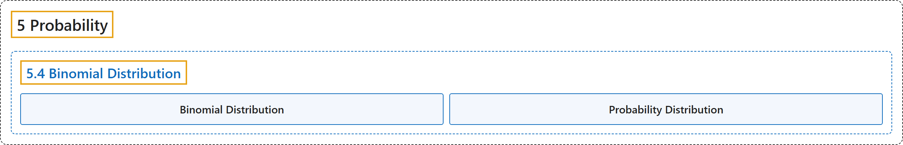

# 5.4 Binomial Distribution

## Classification

## Glossary

| Term | Definition | 中文翻译 | Source |
|---|---|---|---|
| **5.4 Binomial Distribution** 二项分布 | (No definition) | （无定义） | [Online Statistics Education, n.d., section 5.4](https://onlinestatbook.com/2/probability/binomial.html) |
| **Binomial Distribution** 二项分布 | "A **probability distribution for independent events for which there are only two possible outcomes** such as a coin flip. If one of the two outcomes is defined as a success, then the probability of exactly $x$ successes out of $N$ trials (events) is given by:" | 一种**适用于只有两种可能结果的独立事件的概率分布**，例如抛硬币。如果将两种结果之一定义为成功，则在 $N$ 次试验（事件）中恰好成功 $x$ 次的概率为： | [Online Statistics Education, n.d., glossary](https://onlinestatbook.com/2/glossary/binomial_dist.html) |
| **Probability Distribution** 概率分布 | "For a discrete random variable, a **probability distribution** contains the probability of each possible outcome. The sum of all probabilities is always 1.0. See binomial distribution for an example. See also probability density function." | 对于离散随机变量，**概率分布**包含每个可能结果的概率。所有概率之和总是 1.0。示例见二项分布。另见概率密度函数。 | [Online Statistics Education, n.d., glossary](https://onlinestatbook.com/2/glossary/probability_distribution.html) |

## References

*Online statistics education: An interactive multimedia course of study*. (n.d.). Rice University, University of Houston Clear Lake, and Tufts University. Retrieved October 29, 2026, from <https://onlinestatbook.com/2/>
