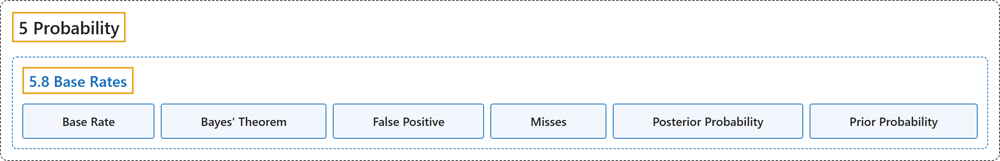

# 5.8 Base Rates

## Classification

## Glossary

| Term | Definition | 中文翻译 | Source |
|---|---|---|---|
| **5.8 Base Rates** 基础比率 | (No definition) | （无定义） | [Online Statistics Education, n.d., section 5.8](https://onlinestatbook.com/2/probability/base_rates.html) |
| **Base Rate** 基础比率 | "The **true proportion of a population** having some condition, attribute or disease. For example, the proportion of people with schizophrenia is about 0.01. It is very important to consider the base rate when classifying people. As the saying goes, "if you hear hoofs, think horse not zebra" since you are more likely to encounter a horse than a zebra (at least in most places.)" | 总体中具有某种状况、属性或疾病的**真实比例**。例如，患精神分裂症的人所占比例约为 0.01。在对人进行分类时，考虑基础比率非常重要。俗话说，“听到马蹄声，要想到马而不是斑马”，因为（至少在大多数地方）遇到马的可能性比遇到斑马更大。 | [Online Statistics Education, n.d., glossary](https://onlinestatbook.com/2/glossary/base_rate.html) |
| **Bayes' Theorem** 贝叶斯定理 | "**Bayes' theorem** considers both the prior probability of an event and the diagnostic value of a test to determine the posterior probability of the event. The theorem is shown below:" | **贝叶斯定理**同时考虑事件的先验概率和检验的诊断价值，以确定该事件的后验概率。该定理如下所示： | [Online Statistics Education, n.d., glossary](https://onlinestatbook.com/2/glossary/bayes.html) |
| **False Positive** 假阳性 | "A **false positive** occurs when **a diagnostic procedure returns a positive result while the true state of the subject is negative**. For example, if a test for strep says the patient has strep when in fact he or she does not, then the error in diagnosis would be called a false positive. In some contexts, a false positive is called a false alarm. The concept is similar to a Type I error in significance testing." | 当**诊断程序给出阳性结果而受试者的真实状态为阴性**时，就出现**假阳性**。例如，如果链球菌检测显示患者感染了链球菌，而实际上并没有，那么这种诊断错误就称为假阳性。在某些情境中，假阳性也称为假警报。这一概念类似于显著性检验中的第一类错误。 | [Online Statistics Education, n.d., glossary](https://onlinestatbook.com/2/glossary/false_positive.html) |
| **Misses** 漏报 | "**Misses** occur when a diagnostic test returns a negative result, but the true state of the subject is positive. For example, if a person has strep throat and the diagnostic test fails to indicate it, then a miss has occurred. The concept is similar to a Type II error in significance testing." | 当诊断测试返回阴性结果而受试者的真实状态为阳性时，就出现**漏报**。例如，如果一个人患有链球菌咽喉炎而诊断测试未能显示，就发生了一次漏报。这一概念类似于显著性检验中的第二类错误。 | [Online Statistics Education, n.d., glossary](https://onlinestatbook.com/2/glossary/misses.html) |
| **Posterior Probability** 后验概率 | "The **posterior probability** of an event is the probability of the event computed following the collection of new data. One begins with a prior probability of an event and revises it in the light of new data. For example, if 0.01 of a population has schizophrenia then the probability that a person drawn at random would have schizophrenia is 0.01. This is the prior probability. If you then learn that their score on a personality test suggests the person is schizophrenic, you would adjust your probability accordingly. The adjusted probability is the posterior probability." | 事件的**后验概率**是在收集新数据之后计算得到的该事件的概率。人们从事件的先验概率出发，根据新数据对其进行修正。例如，如果总体中有 0.01 的人患精神分裂症，则随机抽取的一个人患精神分裂症的概率为 0.01。这就是先验概率。如果随后得知此人在人格测验中的得分表明其患有精神分裂症，就会相应地调整概率。调整后的概率就是后验概率。 | [Online Statistics Education, n.d., glossary](https://onlinestatbook.com/2/glossary/posterior_probability.html) |
| **Prior Probability** 先验概率 | "The **prior probability** of an event is the probability of the event computed before the collection of new data. One begins with a prior probability of an event and revises it in the light of new data. For example, if 0.01 of a population has schizophrenia then the probability that a person drawn at random would have schizophrenia is 0.01. This is the prior probability. If you then learn that that there score on a personality test suggests the person is schizophrenic, you would adjust your probability accordingly. The adjusted probability is the posterior probability." | 事件的**先验概率**是在收集新数据之前计算得到的该事件的概率。人们从事件的先验概率出发，根据新数据对其进行修正。例如，如果总体中有 0.01 的人患精神分裂症，则随机抽取的一个人患精神分裂症的概率为 0.01。这就是先验概率。如果随后得知此人在人格测验中的得分表明其患有精神分裂症，就会相应地调整概率。调整后的概率就是后验概率。 | [Online Statistics Education, n.d., glossary](https://onlinestatbook.com/2/glossary/prior_probability.html) |

## References

*Online statistics education: An interactive multimedia course of study*. (n.d.). Rice University, University of Houston Clear Lake, and Tufts University. Retrieved October 29, 2026, from <https://onlinestatbook.com/2/>
