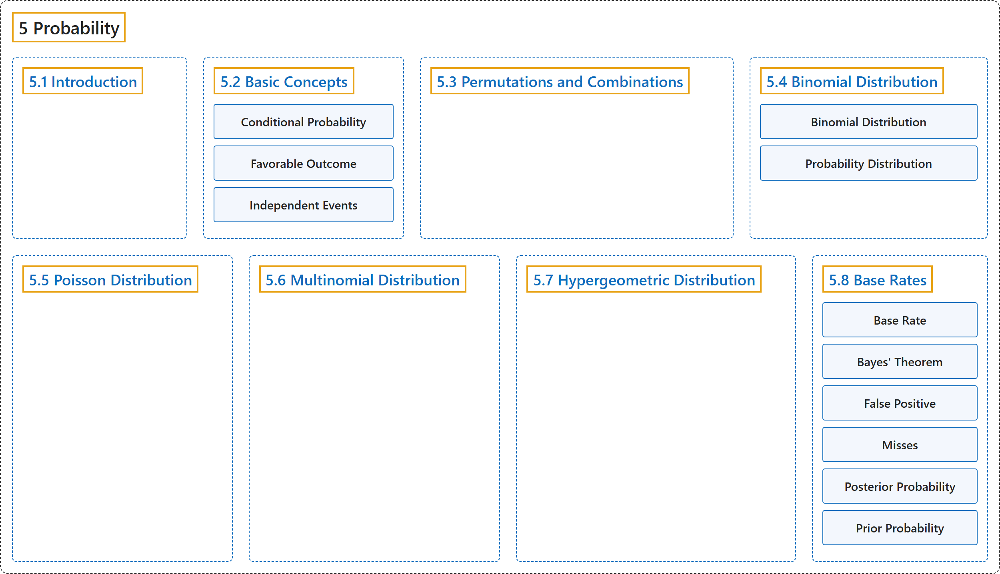

# 5 Probability

## Classification

## Glossary

| Term | Definition | 中文翻译 | Source |
|---|---|---|---|
| **5 Probability** 概率 | (No definition) | （无定义） | [Online Statistics Education, n.d., chapter 5](https://onlinestatbook.com/2/probability/probability.html) |
| **[5.1 Introduction](5-1-introduction.md)** 介绍 | (No definition) | （无定义） | [Online Statistics Education, n.d., section 5.1](https://onlinestatbook.com/2/probability/probability_intro.html) |
| **[5.2 Basic Concepts](5-2-basic-concepts.md)** 基本概念 | (No definition) | （无定义） | [Online Statistics Education, n.d., section 5.2](https://onlinestatbook.com/2/probability/basic.html) |
| **[5.3 Permutations and Combinations](5-3-permutations-and-combinations.md)** 排列与组合 | (No definition) | （无定义） | [Online Statistics Education, n.d., section 5.3](https://onlinestatbook.com/2/probability/permutations.html) |
| **[5.4 Binomial Distribution](5-4-binomial-distribution.md)** 二项分布 | (No definition) | （无定义） | [Online Statistics Education, n.d., section 5.4](https://onlinestatbook.com/2/probability/binomial.html) |
| **[5.5 Poisson Distribution](5-5-poisson-distribution.md)** 泊松分布 | (No definition) | （无定义） | [Online Statistics Education, n.d., section 5.5](https://onlinestatbook.com/2/probability/poisson.html) |
| **[5.6 Multinomial Distribution](5-6-multinomial-distribution.md)** 多项分布 | (No definition) | （无定义） | [Online Statistics Education, n.d., section 5.6](https://onlinestatbook.com/2/probability/multinomial.html) |
| **[5.7 Hypergeometric Distribution](5-7-hypergeometric-distribution.md)** 超几何分布 | (No definition) | （无定义） | [Online Statistics Education, n.d., section 5.7](https://onlinestatbook.com/2/probability/hypergeometric.html) |
| **[5.8 Base Rates](5-8-base-rates.md)** 基础比率 | (No definition) | （无定义） | [Online Statistics Education, n.d., section 5.8](https://onlinestatbook.com/2/probability/base_rates.html) |

## References

*Online statistics education: An interactive multimedia course of study*. (n.d.). Rice University, University of Houston Clear Lake, and Tufts University. Retrieved October 29, 2026, from <https://onlinestatbook.com/2/>
