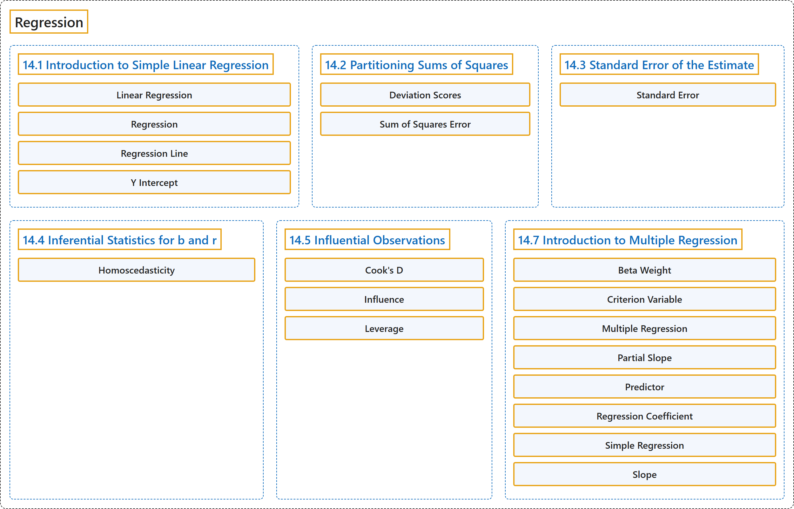

# 14 Regression

## Classification

## Glossary

| Term | Definition | 中文翻译 | Source |
|---|---|---|---|
| **14 Regression** 回归 | (No definition) | （无定义） | [Online Statistics Education, n.d., chapter 14](https://onlinestatbook.com/2/regression/regression.html) |
| **14.1 Introduction to Simple Linear Regression** 简单线性回归简介 | (No definition) | （无定义） | [Online Statistics Education, n.d., section 14.1](https://onlinestatbook.com/2/regression/intro.html) |
| **Linear Regression** 线性回归 | "**Linear regression** is a method for **predicting a criterion variable from one or more predictor variable**. In simple regression, the criterion is predicted from a single predictor variable and the best-fitting straight line is of the form" | **线性回归**是一种**根据一个或多个预测变量来预测效标变量**的方法。在简单回归中，效标由单个预测变量预测，最佳拟合直线的形式为 | [Online Statistics Education, n.d., glossary](https://onlinestatbook.com/2/glossary/linear_regression.html) |
| **Regression** 回归 | "**Regression** means "prediction." The regression of $Y$ on $X$ means the prediction of $Y$ by $X$. See also: linear regression." | **回归**意为“预测”。$Y$ 对 $X$ 的回归意为用 $X$ 预测 $Y$。另见：线性回归。 | [Online Statistics Education, n.d., glossary](https://onlinestatbook.com/2/glossary/regression.html) |
| **Regression Line** 回归线 | "In linear regression, the line of best fit is called the **regression line**." | 在线性回归中，最佳拟合线称为**回归线**。 | [Online Statistics Education, n.d., glossary](https://onlinestatbook.com/2/glossary/regression_line.html) |
| **Y Intercept** Y 截距 | "The $Y$-intercept of a line is **the value of $Y$ at the point that the line intercepts the $Y$ axis**. It is the value of $Y$ when $X$ equals 0. The $Y$ intercept of the black line shown in the graph is 0.785" | 直线的 $Y$ 截距是**该直线与 $Y$ 轴相交的点处 $Y$ 的值**。它是 $X$ 等于 0 时 $Y$ 的值。图中所示黑线的 $Y$ 截距为 0.785 | [Online Statistics Education, n.d., glossary](https://onlinestatbook.com/2/glossary/y_intercept.html) |
| **14.2 Partitioning Sums of Squares** 平方和的分解 | (No definition) | （无定义） | [Online Statistics Education, n.d., section 14.2](https://onlinestatbook.com/2/regression/partitioning.html) |
| **Deviation Scores** 离差分数 | "Scores that are expressed as **differences (deviations) from some value, usually the mean**. To convert data to deviation scores typically means to subtract the mean score from each other score. Thus, the values 1, 2, and 3 in deviation-score form would be computed by subtracting the mean of 2 from each value and would be -1, 0, 1." | **以与某个值（通常是均值）的差（离差）表示**的分数。将数据转换为离差分数通常意味着从其他每个分数中减去均值。因此，值 1、2 和 3 的离差分数形式是用每个值减去均值 2 算出的，结果为 -1、0、1。 | [Online Statistics Education, n.d., glossary](https://onlinestatbook.com/2/glossary/deviation_scores.html) |
| **Sum of Squares Error** 误差平方和 | "In linear regression, the **sum of squares error** is the **sum of squared errors of prediction**. In analysis of variance, it is the sum of squared deviations from cell means for between-subjects factors and the Subjects $\times$ Treatment interaction for within-subject factors." | 在线性回归中，**误差平方和**是**预测误差的平方和**。在方差分析中，对于被试间因素，它是与单元格均值的离差平方和；对于被试内因素，它是被试 $\times$ 处理交互作用。 | [Online Statistics Education, n.d., glossary](https://onlinestatbook.com/2/glossary/sse.html) |
| **14.3 Standard Error of the Estimate** 估计的标准误 | (No definition) | （无定义） | [Online Statistics Education, n.d., section 14.3](https://onlinestatbook.com/2/regression/accuracy.html) |
| **Standard Error** 标准误 | "The **standard error** of a statistic is **the standard deviation of the sampling distribution of that statistic**. For example, the standard error of the mean is the standard deviation of the sampling distribution of the mean. Standard errors play a critical role in constructing confidence intervals and in significance testing." | 统计量的**标准误**是**该统计量抽样分布的标准差**。例如，均值的标准误是均值抽样分布的标准差。标准误在构造置信区间和显著性检验中起关键作用。 | [Online Statistics Education, n.d., glossary](https://onlinestatbook.com/2/glossary/standard_error.html) |
| **14.4 Inferential Statistics for b and r** b 与 r 的推断统计 | (No definition) | （无定义） | [Online Statistics Education, n.d., section 14.4](https://onlinestatbook.com/2/regression/inferential.html) |
| **Homoscedasticity** 同方差性 | "In linear regression, the assumption that **the variance around the regression line is the same for all values of the predictor variable**." | 在线性回归中，指**回归线周围的方差对预测变量的所有取值都相同**的假设。 | [Online Statistics Education, n.d., glossary](https://onlinestatbook.com/2/glossary/homoscedasticity.html) |
| **14.5 Influential Observations** 强影响观测 | (No definition) | （无定义） | [Online Statistics Education, n.d., section 14.5](https://onlinestatbook.com/2/regression/influential.html) |
| **Cook's D** 库克距离 | "**Cook's D** is a measure of the influence of an observation in regression and is proportional to the sum of the squared differences between predictions made with all observations in the analysis and predictions made leaving out the observation in question." | **库克距离 D** 是衡量回归中某个观测的影响的指标，它与分析中使用全部观测所作预测和剔除所讨论观测后所作预测之间的平方差之和成正比。 | [Online Statistics Education, n.d., glossary](https://onlinestatbook.com/2/glossary/cooks_d.html) |
| **Influence** 影响 | "**Influence** refers to the degree to which a single observation in regression influences the estimation of the regression parameters. It is often measured in terms how much the predicted scores for other observations would differ if the observation in question were not included." | **影响**指回归中单个观测对回归参数估计的影响程度。它通常用如果不包含所讨论的观测，其他观测的预测得分会有多大差异来衡量。 | [Online Statistics Education, n.d., glossary](https://onlinestatbook.com/2/glossary/influence.html) |
| **Leverage** 杠杆值 | "**Leverage** is a factor affecting the influence of an observation in regression. Leverage is based on how much the observation's value on the predictor variable differs from the mean of the predictor variable. The greater an observation's leverage, the more potential it has to be an influential observation." | **杠杆值**是影响回归中某个观测值影响力的一个因素。杠杆值取决于该观测值在预测变量上的取值与预测变量均值的差异有多大。观测值的杠杆值越大，它成为强影响观测值的可能性就越大。 | [Online Statistics Education, n.d., glossary](https://onlinestatbook.com/2/glossary/leverage.html) |
| **14.7 Introduction to Multiple Regression** 多元回归简介 | (No definition) | （无定义） | [Online Statistics Education, n.d., section 14.7](https://onlinestatbook.com/2/regression/multiple_regression.html) |
| **Beta Weight** 贝塔权重 | "A **standardized regression coefficient**." | **标准化回归系数**。 | [Online Statistics Education, n.d., glossary](https://onlinestatbook.com/2/glossary/beta_weight.html) |
| **Criterion Variable** 效标变量 | "In regression analysis (such as linear regression) the **criterion variable** is the variable being predicted. In general, the criterion variable is the dependent variable." | 在回归分析（如线性回归）中，**效标变量**是被预测的变量。一般而言，效标变量就是因变量。 | [Online Statistics Education, n.d., glossary](https://onlinestatbook.com/2/glossary/criterion_variable.html) |
| **Multiple Regression** 多元回归 | "**Multiple regression** is linear regression in which **two or more predictor variables** are used to predict the criterion." | **多元回归**是使用**两个或多个预测变量**来预测效标的线性回归。 | [Online Statistics Education, n.d., glossary](https://onlinestatbook.com/2/glossary/multiple_regression.html) |
| **Partial Slope** 偏斜率 | "The **partial slope** in multiple regression is the slope of the relationship between a predictor variable that is independent of the other predictor variables and the criterion. It is also the regression coefficient for the predictor variable in question." | 多元回归中的**偏斜率**是某个与其他预测变量无关的预测变量同效标之间关系的斜率。它也是所讨论预测变量的回归系数。 | [Online Statistics Education, n.d., glossary](https://onlinestatbook.com/2/glossary/partial_slope.html) |
| **Predictor** 预测变量 | "A **predictor variable** is a **variable used in regression to predict another variable**. It is sometimes referred to as an independent variable if it is manipulated rather than just measured." | **预测变量**是**回归中用来预测另一个变量的变量**。如果它是被操纵的而不仅仅是被测量的，有时也称其为自变量。 | [Online Statistics Education, n.d., glossary](https://onlinestatbook.com/2/glossary/predictor.html) |
| **Regression Coefficient** 回归系数 | "A **regression coefficient** is the **slope of the regression line in simple regression or the partial slope in multiple regression**." | **回归系数**是**简单回归中回归线的斜率或多元回归中的偏斜率**。 | [Online Statistics Education, n.d., glossary](https://onlinestatbook.com/2/glossary/regression_coefficient.html) |
| **Simple Regression** 简单回归 | "**Simple regression** is **linear regression in which one more predictor variable is used to predict the criterion**." | **简单回归**是**使用一个以上预测变量来预测效标的线性回归**。 | [Online Statistics Education, n.d., glossary](https://onlinestatbook.com/2/glossary/simple_regression.html) |
| **Slope** 斜率 | "The **slope** of a line is the change in $Y$ for each change of one unit of $X$. It is sometimes defined as "rise over run" which is the same thing. The slope of the black line in the graph is 0.425 because the line increases by 0.425 each time $X$ increases by 1.0." | 直线的**斜率**是 $X$ 每变化一个单位时 $Y$ 的变化量。它有时被定义为“上升量除以水平移动量”，这是同一回事。图中黑线的斜率为 0.425，因为 $X$ 每增加 1.0，该线就上升 0.425。 | [Online Statistics Education, n.d., glossary](https://onlinestatbook.com/2/glossary/slope.html) |

## References

*Online statistics education: An interactive multimedia course of study*. (n.d.). Rice University, University of Houston Clear Lake, and Tufts University. Retrieved October 29, 2026, from <https://onlinestatbook.com/2/>
