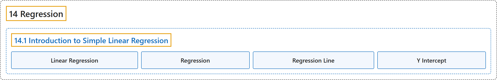

# 14.1 Introduction to Simple Linear Regression

## Classification

## Glossary

| Term | Definition | 中文翻译 | Source |
|---|---|---|---|
| **14.1 Introduction to Simple Linear Regression** 简单线性回归介绍 | (No definition) | （无定义） | [Online Statistics Education, n.d., section 14.1](https://onlinestatbook.com/2/regression/intro.html) |
| **Linear Regression** 线性回归 | "**Linear regression** is a method for **predicting a criterion variable from one or more predictor variable**. In simple regression, the criterion is predicted from a single predictor variable and the best-fitting straight line is of the form" | **线性回归**是一种**根据一个或多个预测变量来预测效标变量**的方法。在简单回归中，效标由单个预测变量预测，最佳拟合直线的形式为 | [Online Statistics Education, n.d., glossary](https://onlinestatbook.com/2/glossary/linear_regression.html) |
| **Regression** 回归 | "**Regression** means "prediction." The regression of $Y$ on $X$ means the prediction of $Y$ by $X$. See also: linear regression." | **回归**意为“预测”。$Y$ 对 $X$ 的回归意为用 $X$ 预测 $Y$。另见：线性回归。 | [Online Statistics Education, n.d., glossary](https://onlinestatbook.com/2/glossary/regression.html) |
| **Regression Line** 回归线 | "In linear regression, the line of best fit is called the **regression line**." | 在线性回归中，最佳拟合线称为**回归线**。 | [Online Statistics Education, n.d., glossary](https://onlinestatbook.com/2/glossary/regression_line.html) |
| **Y Intercept** Y 截距 | "The $Y$-intercept of a line is **the value of $Y$ at the point that the line intercepts the $Y$ axis**. It is the value of $Y$ when $X$ equals 0. The $Y$ intercept of the black line shown in the graph is 0.785" | 直线的 $Y$ 截距是**该直线与 $Y$ 轴相交的点处 $Y$ 的值**。它是 $X$ 等于 0 时 $Y$ 的值。图中所示黑线的 $Y$ 截距为 0.785 | [Online Statistics Education, n.d., glossary](https://onlinestatbook.com/2/glossary/y_intercept.html) |

## References

*Online statistics education: An interactive multimedia course of study*. (n.d.). Rice University, University of Houston Clear Lake, and Tufts University. Retrieved October 29, 2026, from <https://onlinestatbook.com/2/>
