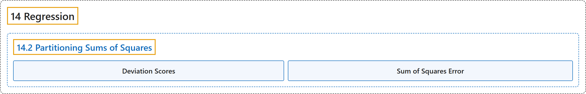

# 14.2 Partitioning Sums of Squares

## Classification

## Glossary

| Term | Definition | 中文翻译 | Source |
|---|---|---|---|
| **14.2 Partitioning Sums of Squares** 平方和的分解 | (No definition) | （无定义） | [Online Statistics Education, n.d., section 14.2](https://onlinestatbook.com/2/regression/partitioning.html) |
| **Deviation Scores** 离差分数 | "Scores that are expressed as **differences (deviations) from some value, usually the mean**. To convert data to deviation scores typically means to subtract the mean score from each other score. Thus, the values 1, 2, and 3 in deviation-score form would be computed by subtracting the mean of 2 from each value and would be -1, 0, 1." | **以与某个值（通常是均值）的差（离差）表示**的分数。将数据转换为离差分数通常意味着从其他每个分数中减去均值。因此，值 1、2 和 3 的离差分数形式是用每个值减去均值 2 算出的，结果为 -1、0、1。 | [Online Statistics Education, n.d., glossary](https://onlinestatbook.com/2/glossary/deviation_scores.html) |
| **Sum of Squares Error** 误差平方和 | "In linear regression, the **sum of squares error** is the **sum of squared errors of prediction**. In analysis of variance, it is the sum of squared deviations from cell means for between-subjects factors and the Subjects $\times$ Treatment interaction for within-subject factors." | 在线性回归中，**误差平方和**是**预测误差的平方和**。在方差分析中，对于被试间因素，它是与单元格均值的离差平方和；对于被试内因素，它是被试 $\times$ 处理交互作用。 | [Online Statistics Education, n.d., glossary](https://onlinestatbook.com/2/glossary/sse.html) |

## References

*Online statistics education: An interactive multimedia course of study*. (n.d.). Rice University, University of Houston Clear Lake, and Tufts University. Retrieved October 29, 2026, from <https://onlinestatbook.com/2/>
