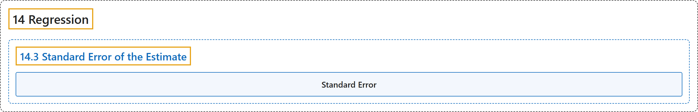

# 14.3 Standard Error of the Estimate

## Classification

## Glossary

| Term | Definition | 中文翻译 | Source |
|---|---|---|---|
| **14.3 Standard Error of the Estimate** 估计的标准误 | (No definition) | （无定义） | [Online Statistics Education, n.d., section 14.3](https://onlinestatbook.com/2/regression/accuracy.html) |
| **Standard Error** 标准误 | "The **standard error** of a statistic is **the standard deviation of the sampling distribution of that statistic**. For example, the standard error of the mean is the standard deviation of the sampling distribution of the mean. Standard errors play a critical role in constructing confidence intervals and in significance testing." | 统计量的**标准误**是**该统计量抽样分布的标准差**。例如，均值的标准误是均值抽样分布的标准差。标准误在构造置信区间和显著性检验中起关键作用。 | [Online Statistics Education, n.d., glossary](https://onlinestatbook.com/2/glossary/standard_error.html) |

## References

*Online statistics education: An interactive multimedia course of study*. (n.d.). Rice University, University of Houston Clear Lake, and Tufts University. Retrieved October 29, 2026, from <https://onlinestatbook.com/2/>
