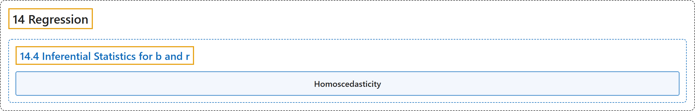

# 14.4 Inferential Statistics for b and r

## Classification

## Glossary

| Term | Definition | 中文翻译 | Source |
|---|---|---|---|
| **14.4 Inferential Statistics for b and r** b 与 r 的推断统计 | (No definition) | （无定义） | [Online Statistics Education, n.d., section 14.4](https://onlinestatbook.com/2/regression/inferential.html) |
| **Homoscedasticity** 同方差性 | "In linear regression, the assumption that **the variance around the regression line is the same for all values of the predictor variable**." | 在线性回归中，指**回归线周围的方差对预测变量的所有取值都相同**的假设。 | [Online Statistics Education, n.d., glossary](https://onlinestatbook.com/2/glossary/homoscedasticity.html) |

## References

*Online statistics education: An interactive multimedia course of study*. (n.d.). Rice University, University of Houston Clear Lake, and Tufts University. Retrieved October 29, 2026, from <https://onlinestatbook.com/2/>
