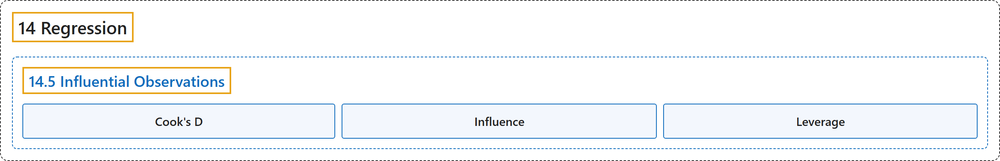

# 14.5 Influential Observations

## Classification

## Glossary

| Term | Definition | 中文翻译 | Source |
|---|---|---|---|
| **14.5 Influential Observations** 强影响观测 | (No definition) | （无定义） | [Online Statistics Education, n.d., section 14.5](https://onlinestatbook.com/2/regression/influential.html) |
| **Cook's D** 库克距离 | "**Cook's D** is a measure of the influence of an observation in regression and is proportional to the sum of the squared differences between predictions made with all observations in the analysis and predictions made leaving out the observation in question." | **库克距离 D** 是衡量回归中某个观测的影响的指标，它与分析中使用全部观测所作预测和剔除所讨论观测后所作预测之间的平方差之和成正比。 | [Online Statistics Education, n.d., glossary](https://onlinestatbook.com/2/glossary/cooks_d.html) |
| **Influence** 影响 | "**Influence** refers to the degree to which a single observation in regression influences the estimation of the regression parameters. It is often measured in terms how much the predicted scores for other observations would differ if the observation in question were not included." | **影响**指回归中单个观测对回归参数估计的影响程度。它通常用如果不包含所讨论的观测，其他观测的预测得分会有多大差异来衡量。 | [Online Statistics Education, n.d., glossary](https://onlinestatbook.com/2/glossary/influence.html) |
| **Leverage** 杠杆值 | "**Leverage** is a factor affecting the influence of an observation in regression. Leverage is based on how much the observation's value on the predictor variable differs from the mean of the predictor variable. The greater an observation's leverage, the more potential it has to be an influential observation." | **杠杆值**是影响回归中某个观测值影响力的一个因素。杠杆值取决于该观测值在预测变量上的取值与预测变量均值的差异有多大。观测值的杠杆值越大，它成为强影响观测值的可能性就越大。 | [Online Statistics Education, n.d., glossary](https://onlinestatbook.com/2/glossary/leverage.html) |

## References

*Online statistics education: An interactive multimedia course of study*. (n.d.). Rice University, University of Houston Clear Lake, and Tufts University. Retrieved October 29, 2026, from <https://onlinestatbook.com/2/>
