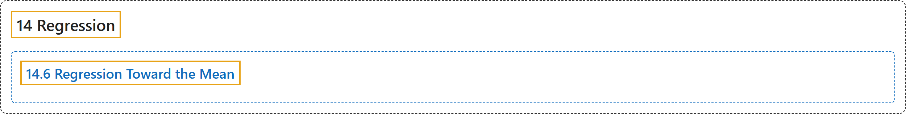

# 14.6 Regression Toward the Mean

## Classification

## Glossary

| Term | Definition | 中文翻译 | Source |
|---|---|---|---|
| **14.6 Regression Toward the Mean** 向均值回归 | (No definition) | （无定义） | [Online Statistics Education, n.d., section 14.6](https://onlinestatbook.com/2/regression/regression_toward_mean.html) |

## References

*Online statistics education: An interactive multimedia course of study*. (n.d.). Rice University, University of Houston Clear Lake, and Tufts University. Retrieved October 29, 2026, from <https://onlinestatbook.com/2/>
