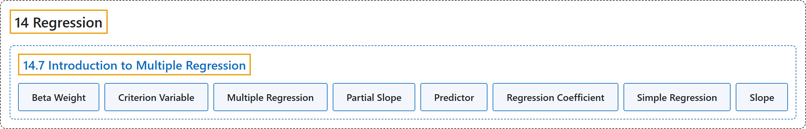

# 14.7 Introduction to Multiple Regression

## Classification

## Glossary

| Term | Definition | 中文翻译 | Source |
|---|---|---|---|
| **14.7 Introduction to Multiple Regression** 多元回归介绍 | (No definition) | （无定义） | [Online Statistics Education, n.d., section 14.7](https://onlinestatbook.com/2/regression/multiple_regression.html) |
| **Beta Weight** 贝塔权重 | "A **standardized regression coefficient**." | **标准化回归系数**。 | [Online Statistics Education, n.d., glossary](https://onlinestatbook.com/2/glossary/beta_weight.html) |
| **Criterion Variable** 效标变量 | "In regression analysis (such as linear regression) the **criterion variable** is the variable being predicted. In general, the criterion variable is the dependent variable." | 在回归分析（如线性回归）中，**效标变量**是被预测的变量。一般而言，效标变量就是因变量。 | [Online Statistics Education, n.d., glossary](https://onlinestatbook.com/2/glossary/criterion_variable.html) |
| **Multiple Regression** 多元回归 | "**Multiple regression** is linear regression in which **two or more predictor variables** are used to predict the criterion." | **多元回归**是使用**两个或多个预测变量**来预测效标的线性回归。 | [Online Statistics Education, n.d., glossary](https://onlinestatbook.com/2/glossary/multiple_regression.html) |
| **Partial Slope** 偏斜率 | "The **partial slope** in multiple regression is the slope of the relationship between a predictor variable that is independent of the other predictor variables and the criterion. It is also the regression coefficient for the predictor variable in question." | 多元回归中的**偏斜率**是某个与其他预测变量无关的预测变量同效标之间关系的斜率。它也是所讨论预测变量的回归系数。 | [Online Statistics Education, n.d., glossary](https://onlinestatbook.com/2/glossary/partial_slope.html) |
| **Predictor** 预测变量 | "A **predictor variable** is a **variable used in regression to predict another variable**. It is sometimes referred to as an independent variable if it is manipulated rather than just measured." | **预测变量**是**回归中用来预测另一个变量的变量**。如果它是被操纵的而不仅仅是被测量的，有时也称其为自变量。 | [Online Statistics Education, n.d., glossary](https://onlinestatbook.com/2/glossary/predictor.html) |
| **Regression Coefficient** 回归系数 | "A **regression coefficient** is the **slope of the regression line in simple regression or the partial slope in multiple regression**." | **回归系数**是**简单回归中回归线的斜率或多元回归中的偏斜率**。 | [Online Statistics Education, n.d., glossary](https://onlinestatbook.com/2/glossary/regression_coefficient.html) |
| **Simple Regression** 简单回归 | "**Simple regression** is **linear regression in which one more predictor variable is used to predict the criterion**." | **简单回归**是**使用一个以上预测变量来预测效标的线性回归**。 | [Online Statistics Education, n.d., glossary](https://onlinestatbook.com/2/glossary/simple_regression.html) |
| **Slope** 斜率 | "The **slope** of a line is the change in $Y$ for each change of one unit of $X$. It is sometimes defined as "rise over run" which is the same thing. The slope of the black line in the graph is 0.425 because the line increases by 0.425 each time $X$ increases by 1.0." | 直线的**斜率**是 $X$ 每变化一个单位时 $Y$ 的变化量。它有时被定义为“上升量除以水平移动量”，这是同一回事。图中黑线的斜率为 0.425，因为 $X$ 每增加 1.0，该线就上升 0.425。 | [Online Statistics Education, n.d., glossary](https://onlinestatbook.com/2/glossary/slope.html) |

## References

*Online statistics education: An interactive multimedia course of study*. (n.d.). Rice University, University of Houston Clear Lake, and Tufts University. Retrieved October 29, 2026, from <https://onlinestatbook.com/2/>
