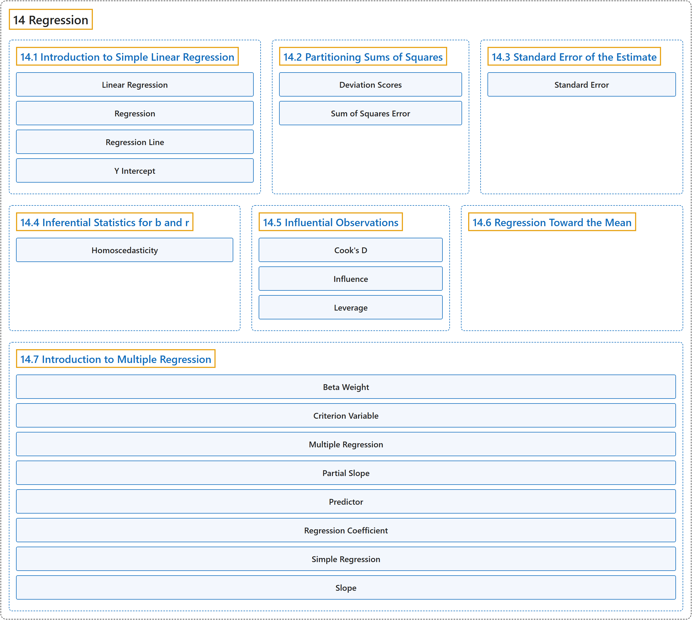

# 14 Regression

## Classification

## Glossary

| Term | Definition | 中文翻译 | Source |
|---|---|---|---|
| **14 Regression** 回归 | (No definition) | （无定义） | [Online Statistics Education, n.d., chapter 14](https://onlinestatbook.com/2/regression/regression.html) |
| **[14.1 Introduction to Simple Linear Regression](14-1-introduction-to-simple-linear-regression.md)** 简单线性回归介绍 | (No definition) | （无定义） | [Online Statistics Education, n.d., section 14.1](https://onlinestatbook.com/2/regression/intro.html) |
| **[14.2 Partitioning Sums of Squares](14-2-partitioning-sums-of-squares.md)** 平方和的分解 | (No definition) | （无定义） | [Online Statistics Education, n.d., section 14.2](https://onlinestatbook.com/2/regression/partitioning.html) |
| **[14.3 Standard Error of the Estimate](14-3-standard-error-of-the-estimate.md)** 估计的标准误 | (No definition) | （无定义） | [Online Statistics Education, n.d., section 14.3](https://onlinestatbook.com/2/regression/accuracy.html) |
| **[14.4 Inferential Statistics for b and r](14-4-inferential-statistics-for-b-and-r.md)** b 与 r 的推断统计 | (No definition) | （无定义） | [Online Statistics Education, n.d., section 14.4](https://onlinestatbook.com/2/regression/inferential.html) |
| **[14.5 Influential Observations](14-5-influential-observations.md)** 强影响观测 | (No definition) | （无定义） | [Online Statistics Education, n.d., section 14.5](https://onlinestatbook.com/2/regression/influential.html) |
| **[14.6 Regression Toward the Mean](14-6-regression-toward-the-mean.md)** 向均值回归 | (No definition) | （无定义） | [Online Statistics Education, n.d., section 14.6](https://onlinestatbook.com/2/regression/regression_toward_mean.html) |
| **[14.7 Introduction to Multiple Regression](14-7-introduction-to-multiple-regression.md)** 多元回归介绍 | (No definition) | （无定义） | [Online Statistics Education, n.d., section 14.7](https://onlinestatbook.com/2/regression/multiple_regression.html) |

## References

*Online statistics education: An interactive multimedia course of study*. (n.d.). Rice University, University of Houston Clear Lake, and Tufts University. Retrieved October 29, 2026, from <https://onlinestatbook.com/2/>
