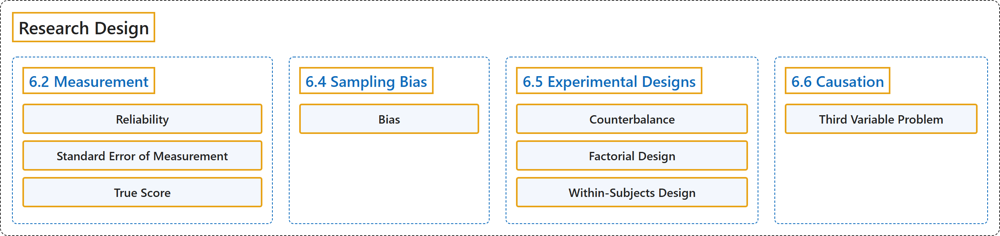

# 6 Research Design

## Classification

## Glossary

| Term | Definition | 中文翻译 | Source |
|---|---|---|---|
| **6 Research Design** 研究设计 | (No definition) | （无定义） | [Online Statistics Education, n.d., chapter 6](https://onlinestatbook.com/2/research_design/contents.html) |
| **6.2 Measurement** 测量 | (No definition) | （无定义） | [Online Statistics Education, n.d., section 6.2](https://onlinestatbook.com/2/research_design/measurement.html) |
| **Reliability** 信度 | "Although there are many ways to conceive of the reliability of a test, the classical way is to define the **reliability** as **the correlation between two parallel forms of the test**. When defined this way, the reliability is the ratio of true score variance to test score variance. Chronbach's $\alpha$ is a common measure of reliability." | 尽管有许多方式来设想一项测验的信度，但经典的方式是将**信度**定义为**测验两个平行形式之间的相关**。这样定义时，信度是真分数方差与测验分数方差之比。Chronbach 的 $\alpha$ 是常用的信度度量。 | [Online Statistics Education, n.d., glossary](https://onlinestatbook.com/2/glossary/reliability.html) |
| **Standard Error of Measurement** 测量标准误 | "In test theory, the **standard error of measurement** is the **standard deviation of observed test scores for a given true score**. It is usually estimated with the following formula in which $s$ is the standard deviation of the test scores and $r$ is the reliability of the test." | 在测验理论中，**测量标准误**是**给定真分数时观测测验分数的标准差**。它通常用下面的公式估计，其中 $s$ 是测验分数的标准差，$r$ 是测验的信度。 | [Online Statistics Education, n.d., glossary](https://onlinestatbook.com/2/glossary/se_measure.html) |
| **True Score** 真分数 | "In classical test theory, the **true score** is a theoretical value that represents a test taker's score without error. If a person took parallel forms of a test thousands of times (assuming no practice or fatigue effects), the mean of all their scores would be a good approximation of their true score since the error would be almost entirely averaged out. It should be distinguished from validity." | 在经典测验理论中，**真分数**是代表应试者无误差得分的理论值。如果一个人把平行形式的测验做了数千次（假设没有练习或疲劳效应），则其所有得分的均值将是其真分数的良好近似，因为误差几乎被完全平均掉了。应将其与效度区分开来。 | [Online Statistics Education, n.d., glossary](https://onlinestatbook.com/2/glossary/true.html) |
| **6.4 Sampling Bias** 抽样偏差 | (No definition) | （无定义） | [Online Statistics Education, n.d., section 6.4](https://onlinestatbook.com/2/research_design/sampling.html) |
| **Bias** 偏倚 | "1. A sampling method is **biased** if each element does not have an equal chance of being selected. A sample of internet users found reading an online statistics book would be a biased sample of all internet users. A random sample is unbiased. Note that possible bias refers to the sampling method, not the result. An unbiased method could, by chance, lead to a very non-representative sample. 2. An estimator is biased if it **systematically overestimates or underestmates the parameter** it is estimating. In other words, it is biased if the mean of the sampling distribution of the statistic is not the paramter it is estimating, The sample mean is an unbiased estimate of the population mean. The mean squared deviation of sample scores from their mean is a biased estimate of the variance since it tends to underestimate the population variance." | 1. 如果每个元素被选中的机会不均等，则抽样方法是**有偏的**。在网上阅读在线统计学书籍的互联网用户样本，将是所有互联网用户的一个有偏样本。随机样本是无偏的。注意，可能的偏倚指的是抽样方法，而不是结果。无偏的方法也可能偶然得到非常缺乏代表性的样本。2. 如果估计量**系统性地高估或低估**其所估计的**参数**，则该估计量是有偏的。换句话说，如果统计量的抽样分布的均值不是它所估计的参数，则它是有偏的。样本均值是总体均值的无偏估计。样本得分与其均值的平均平方偏差是方差的有偏估计，因为它往往会低估总体方差。 | [Online Statistics Education, n.d., glossary](https://onlinestatbook.com/2/glossary/bias.html) |
| **6.5 Experimental Designs** 实验设计 | (No definition) | （无定义） | [Online Statistics Education, n.d., section 6.5](https://onlinestatbook.com/2/research_design/designs.html) |
| **Counterbalance** 平衡 | "**Counterbalancing** is a method of avoiding confounding among variables. Consider an experiment in which subjects are tested on both an auditory reaction time task (in which subjects respond to an auditory stimulus) and a visual reaction time task (in which subjects respond to a visual stimulus). Half of the subjects are given the visual task first and the other half of the subjects are given the auditory task first. That way, there is no confounding of order of presentation and task." | **平衡**是避免变量之间混淆的一种方法。考虑这样一个实验：被试既要接受听觉反应时任务（被试对听觉刺激作出反应）的测试，也要接受视觉反应时任务（被试对视觉刺激作出反应）的测试。一半被试先做视觉任务，另一半被试先做听觉任务。这样，呈现顺序与任务之间就不存在混淆。 | [Online Statistics Education, n.d., glossary](https://onlinestatbook.com/2/glossary/counterbalance.html) |
| **Factorial Design** 析因设计 | "In a **factorial design**, each level of each independent variable is paired with each level of each other independent variable. Thus, a 2 x 3 factorial design consists of the 6 possible combinations of the levels of the independent variables." | 在**析因设计**中，每个自变量的每个水平都与其他每个自变量的每个水平配对。因此，2 x 3 析因设计由自变量各水平的 6 种可能组合构成。 | [Online Statistics Education, n.d., glossary](https://onlinestatbook.com/2/glossary/factorial_design.html) |
| **Within-Subjects Design** 被试内设计 | "An experimental design in which the independent variable is a **within-subjects variable**." | 自变量是**被试内变量**的实验设计。 | [Online Statistics Education, n.d., glossary](https://onlinestatbook.com/2/glossary/within_design.html) |
| **6.6 Causation** 因果关系 | (No definition) | （无定义） | [Online Statistics Education, n.d., section 6.6](https://onlinestatbook.com/2/research_design/causation.html) |
| **Third Variable Problem** 第三变量问题 | "A type of confounding in which **a third variable leads to a mistaken causal relationship between two others**. For instance, cities with a greater number of churches have a higher crime rate. However, more churches do not lead to more crime, but instead the third variable, population, leads to both more churches and more crime." | 一种混淆，其中**第三个变量导致另外两个变量之间出现错误的因果关系**。例如，教堂数量较多的城市犯罪率较高。然而，更多的教堂并不会导致更多的犯罪，而是第三个变量人口既导致教堂增多，也导致犯罪增多。 | [Online Statistics Education, n.d., glossary](https://onlinestatbook.com/2/glossary/third_variable_problem.html) |

## References

*Online statistics education: An interactive multimedia course of study*. (n.d.). Rice University, University of Houston Clear Lake, and Tufts University. Retrieved October 29, 2026, from <https://onlinestatbook.com/2/>
