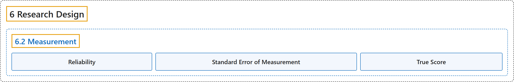

# 6.2 Measurement

## Classification

## Glossary

| Term | Definition | 中文翻译 | Source |
|---|---|---|---|
| **6.2 Measurement** 测量 | (No definition) | （无定义） | [Online Statistics Education, n.d., section 6.2](https://onlinestatbook.com/2/research_design/measurement.html) |
| **Reliability** 信度 | "Although there are many ways to conceive of the reliability of a test, the classical way is to define the **reliability** as **the correlation between two parallel forms of the test**. When defined this way, the reliability is the ratio of true score variance to test score variance. Chronbach's $\alpha$ is a common measure of reliability." | 尽管有许多方式来设想一项测验的信度，但经典的方式是将**信度**定义为**测验两个平行形式之间的相关**。这样定义时，信度是真分数方差与测验分数方差之比。Chronbach 的 $\alpha$ 是常用的信度度量。 | [Online Statistics Education, n.d., glossary](https://onlinestatbook.com/2/glossary/reliability.html) |
| **Standard Error of Measurement** 测量标准误 | "In test theory, the **standard error of measurement** is the **standard deviation of observed test scores for a given true score**. It is usually estimated with the following formula in which $s$ is the standard deviation of the test scores and $r$ is the reliability of the test." | 在测验理论中，**测量标准误**是**给定真分数时观测测验分数的标准差**。它通常用下面的公式估计，其中 $s$ 是测验分数的标准差，$r$ 是测验的信度。 | [Online Statistics Education, n.d., glossary](https://onlinestatbook.com/2/glossary/se_measure.html) |
| **True Score** 真分数 | "In classical test theory, the **true score** is a theoretical value that represents a test taker's score without error. If a person took parallel forms of a test thousands of times (assuming no practice or fatigue effects), the mean of all their scores would be a good approximation of their true score since the error would be almost entirely averaged out. It should be distinguished from validity." | 在经典测验理论中，**真分数**是代表应试者无误差得分的理论值。如果一个人把平行形式的测验做了数千次（假设没有练习或疲劳效应），则其所有得分的均值将是其真分数的良好近似，因为误差几乎被完全平均掉了。应将其与效度区分开来。 | [Online Statistics Education, n.d., glossary](https://onlinestatbook.com/2/glossary/true.html) |

## References

*Online statistics education: An interactive multimedia course of study*. (n.d.). Rice University, University of Houston Clear Lake, and Tufts University. Retrieved October 29, 2026, from <https://onlinestatbook.com/2/>
