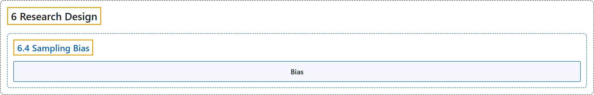

# 6.4 Sampling Bias

## Classification

## Glossary

| Term | Definition | 中文翻译 | Source |
|---|---|---|---|
| **6.4 Sampling Bias** 抽样偏差 | (No definition) | （无定义） | [Online Statistics Education, n.d., section 6.4](https://onlinestatbook.com/2/research_design/sampling.html) |
| **Bias** 偏倚 | "1. A sampling method is **biased** if each element does not have an equal chance of being selected. A sample of internet users found reading an online statistics book would be a biased sample of all internet users. A random sample is unbiased. Note that possible bias refers to the sampling method, not the result. An unbiased method could, by chance, lead to a very non-representative sample. 2. An estimator is biased if it **systematically overestimates or underestmates the parameter** it is estimating. In other words, it is biased if the mean of the sampling distribution of the statistic is not the paramter it is estimating, The sample mean is an unbiased estimate of the population mean. The mean squared deviation of sample scores from their mean is a biased estimate of the variance since it tends to underestimate the population variance." | 1. 如果每个元素被选中的机会不均等，则抽样方法是**有偏的**。在网上阅读在线统计学书籍的互联网用户样本，将是所有互联网用户的一个有偏样本。随机样本是无偏的。注意，可能的偏倚指的是抽样方法，而不是结果。无偏的方法也可能偶然得到非常缺乏代表性的样本。2. 如果估计量**系统性地高估或低估**其所估计的**参数**，则该估计量是有偏的。换句话说，如果统计量的抽样分布的均值不是它所估计的参数，则它是有偏的。样本均值是总体均值的无偏估计。样本得分与其均值的平均平方偏差是方差的有偏估计，因为它往往会低估总体方差。 | [Online Statistics Education, n.d., glossary](https://onlinestatbook.com/2/glossary/bias.html) |

## References

*Online statistics education: An interactive multimedia course of study*. (n.d.). Rice University, University of Houston Clear Lake, and Tufts University. Retrieved October 29, 2026, from <https://onlinestatbook.com/2/>
