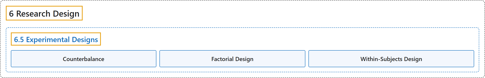

# 6.5 Experimental Designs

## Classification

## Glossary

| Term | Definition | 中文翻译 | Source |
|---|---|---|---|
| **6.5 Experimental Designs** 实验设计 | (No definition) | （无定义） | [Online Statistics Education, n.d., section 6.5](https://onlinestatbook.com/2/research_design/designs.html) |
| **Counterbalance** 平衡 | "**Counterbalancing** is a method of avoiding confounding among variables. Consider an experiment in which subjects are tested on both an auditory reaction time task (in which subjects respond to an auditory stimulus) and a visual reaction time task (in which subjects respond to a visual stimulus). Half of the subjects are given the visual task first and the other half of the subjects are given the auditory task first. That way, there is no confounding of order of presentation and task." | **平衡**是避免变量之间混淆的一种方法。考虑这样一个实验：被试既要接受听觉反应时任务（被试对听觉刺激作出反应）的测试，也要接受视觉反应时任务（被试对视觉刺激作出反应）的测试。一半被试先做视觉任务，另一半被试先做听觉任务。这样，呈现顺序与任务之间就不存在混淆。 | [Online Statistics Education, n.d., glossary](https://onlinestatbook.com/2/glossary/counterbalance.html) |
| **Factorial Design** 析因设计 | "In a **factorial design**, each level of each independent variable is paired with each level of each other independent variable. Thus, a 2 x 3 factorial design consists of the 6 possible combinations of the levels of the independent variables." | 在**析因设计**中，每个自变量的每个水平都与其他每个自变量的每个水平配对。因此，2 x 3 析因设计由自变量各水平的 6 种可能组合构成。 | [Online Statistics Education, n.d., glossary](https://onlinestatbook.com/2/glossary/factorial_design.html) |
| **Within-Subjects Design** 被试内设计 | "An experimental design in which the independent variable is a **within-subjects variable**." | 自变量是**被试内变量**的实验设计。 | [Online Statistics Education, n.d., glossary](https://onlinestatbook.com/2/glossary/within_design.html) |

## References

*Online statistics education: An interactive multimedia course of study*. (n.d.). Rice University, University of Houston Clear Lake, and Tufts University. Retrieved October 29, 2026, from <https://onlinestatbook.com/2/>
