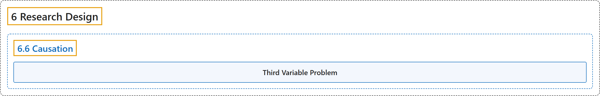

# 6.6 Causation

## Classification

## Glossary

| Term | Definition | 中文翻译 | Source |
|---|---|---|---|
| **6.6 Causation** 因果关系 | (No definition) | （无定义） | [Online Statistics Education, n.d., section 6.6](https://onlinestatbook.com/2/research_design/causation.html) |
| **Third Variable Problem** 第三变量问题 | "A type of confounding in which **a third variable leads to a mistaken causal relationship between two others**. For instance, cities with a greater number of churches have a higher crime rate. However, more churches do not lead to more crime, but instead the third variable, population, leads to both more churches and more crime." | 一种混淆，其中**第三个变量导致另外两个变量之间出现错误的因果关系**。例如，教堂数量较多的城市犯罪率较高。然而，更多的教堂并不会导致更多的犯罪，而是第三个变量人口既导致教堂增多，也导致犯罪增多。 | [Online Statistics Education, n.d., glossary](https://onlinestatbook.com/2/glossary/third_variable_problem.html) |

## References

*Online statistics education: An interactive multimedia course of study*. (n.d.). Rice University, University of Houston Clear Lake, and Tufts University. Retrieved October 29, 2026, from <https://onlinestatbook.com/2/>
