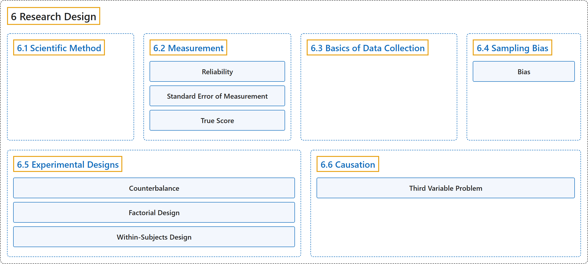

# 6 Research Design

## Classification

## Glossary

| Term | Definition | 中文翻译 | Source |
|---|---|---|---|
| **6 Research Design** 研究设计 | (No definition) | （无定义） | [Online Statistics Education, n.d., chapter 6](https://onlinestatbook.com/2/research_design/contents.html) |
| **[6.1 Scientific Method](6-1-scientific-method.md)** 科学方法 | (No definition) | （无定义） | [Online Statistics Education, n.d., section 6.1](https://onlinestatbook.com/2/research_design/scientific.html) |
| **[6.2 Measurement](6-2-measurement.md)** 测量 | (No definition) | （无定义） | [Online Statistics Education, n.d., section 6.2](https://onlinestatbook.com/2/research_design/measurement.html) |
| **[6.3 Basics of Data Collection](6-3-basics-of-data-collection.md)** 数据收集基础 | (No definition) | （无定义） | [Online Statistics Education, n.d., section 6.3](https://onlinestatbook.com/2/research_design/data_collection.html) |
| **[6.4 Sampling Bias](6-4-sampling-bias.md)** 抽样偏差 | (No definition) | （无定义） | [Online Statistics Education, n.d., section 6.4](https://onlinestatbook.com/2/research_design/sampling.html) |
| **[6.5 Experimental Designs](6-5-experimental-designs.md)** 实验设计 | (No definition) | （无定义） | [Online Statistics Education, n.d., section 6.5](https://onlinestatbook.com/2/research_design/designs.html) |
| **[6.6 Causation](6-6-causation.md)** 因果关系 | (No definition) | （无定义） | [Online Statistics Education, n.d., section 6.6](https://onlinestatbook.com/2/research_design/causation.html) |

## References

*Online statistics education: An interactive multimedia course of study*. (n.d.). Rice University, University of Houston Clear Lake, and Tufts University. Retrieved October 29, 2026, from <https://onlinestatbook.com/2/>
