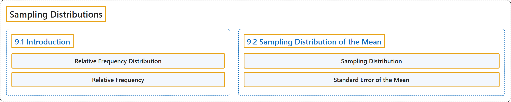

# 9 Sampling Distributions

## Classification

## Glossary

| Term | Definition | 中文翻译 | Source |
|---|---|---|---|
| **9 Sampling Distributions** 抽样分布 | (No definition) | （无定义） | [Online Statistics Education, n.d., chapter 9](https://onlinestatbook.com/2/sampling_distributions/sampling_distributions.html) |
| **9.1 Introduction** 引言 | (No definition) | （无定义） | [Online Statistics Education, n.d., section 9.1](https://onlinestatbook.com/2/sampling_distributions/intro_samp_dist.html) |
| **Relative Frequency Distribution** 相对频数分布 | "A **relative frequency distribution** is just like a frequency distribution except that it consists of **the proportions of occurrences instead of the numbers of occurrences** for each value (or range of values) of a variable." | **相对频数分布**与频数分布完全相同，只是它对变量的每个值（或值的范围）给出的是**出现的比例而不是出现的次数**。 | [Online Statistics Education, n.d., glossary](https://onlinestatbook.com/2/glossary/relative_freq_dist.html) |
| **Relative Frequency** 相对频数 | "The **proportion of observations falling into a given class**. For example, if a bag of 55 M & M's has 11 green M&M's, then the frequency of green M&M's is 11 and the relative frequency is 11/55 = 0.20. Relative frequencies are often used in histograms, pie charts, and bar graphs." | **落入给定类别的观测所占的比例**。例如，如果一袋 55 颗 M & M's 中有 11 颗绿色 M&M's，则绿色 M&M's 的频数为 11，**相对频数**为 11/55 = 0.20。相对频数常用于直方图、饼图和条形图。 | [Online Statistics Education, n.d., glossary](https://onlinestatbook.com/2/glossary/relative_frequency.html) |
| **9.2 Sampling Distribution of the Mean** 均值的抽样分布 | (No definition) | （无定义） | [Online Statistics Education, n.d., section 9.2](https://onlinestatbook.com/2/sampling_distributions/samp_dist_mean.html) |
| **Sampling Distribution** 抽样分布 | "A **sampling distribution** can be thought of as **a relative frequency distribution with a very large number of samples**. More precisely, a relative frequency distribution approaches the sampling distribution as the number of samples approaches infinity. When a variable is discrete, the heights of the distribution are probabilities. When a variable is continuous, the class intervals have no width and and the heights of the distribution are probability densities." | **抽样分布**可以看作**样本数量非常大的相对频数分布**。更准确地说，当样本数量趋于无穷时，相对频数分布趋近于抽样分布。当变量是离散的时，分布的高度是概率。当变量是连续的时，组距没有宽度，分布的高度是概率密度。 | [Online Statistics Education, n.d., glossary](https://onlinestatbook.com/2/glossary/sampling_distribution.html) |
| **Standard Error of the Mean** 均值的标准误 | "The **standard error of the mean** is the **standard deviation of the sampling distribution of the mean**. The formula for the standard error of the mean in a population is:" | **均值的标准误**是**均值抽样分布的标准差**。总体中均值的标准误的公式为： | [Online Statistics Education, n.d., glossary](https://onlinestatbook.com/2/glossary/sem.html) |

## References

*Online statistics education: An interactive multimedia course of study*. (n.d.). Rice University, University of Houston Clear Lake, and Tufts University. Retrieved October 29, 2026, from <https://onlinestatbook.com/2/>
