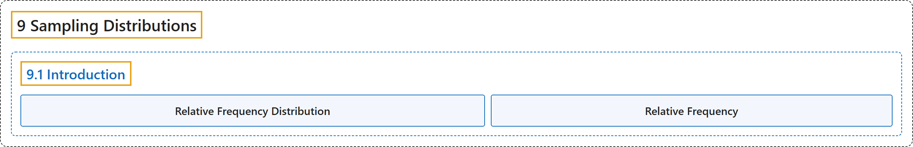

# 9.1 Introduction

## Classification

## Glossary

| Term | Definition | 中文翻译 | Source |
|---|---|---|---|
| **9.1 Introduction** 介绍 | (No definition) | （无定义） | [Online Statistics Education, n.d., section 9.1](https://onlinestatbook.com/2/sampling_distributions/intro_samp_dist.html) |
| **Relative Frequency Distribution** 相对频数分布 | "A **relative frequency distribution** is just like a frequency distribution except that it consists of **the proportions of occurrences instead of the numbers of occurrences** for each value (or range of values) of a variable." | **相对频数分布**与频数分布完全相同，只是它对变量的每个值（或值的范围）给出的是**出现的比例而不是出现的次数**。 | [Online Statistics Education, n.d., glossary](https://onlinestatbook.com/2/glossary/relative_freq_dist.html) |
| **Relative Frequency** 相对频数 | "The **proportion of observations falling into a given class**. For example, if a bag of 55 M & M's has 11 green M&M's, then the frequency of green M&M's is 11 and the relative frequency is 11/55 = 0.20. Relative frequencies are often used in histograms, pie charts, and bar graphs." | **落入给定类别的观测所占的比例**。例如，如果一袋 55 颗 M & M's 中有 11 颗绿色 M&M's，则绿色 M&M's 的频数为 11，**相对频数**为 11/55 = 0.20。相对频数常用于直方图、饼图和条形图。 | [Online Statistics Education, n.d., glossary](https://onlinestatbook.com/2/glossary/relative_frequency.html) |

## References

*Online statistics education: An interactive multimedia course of study*. (n.d.). Rice University, University of Houston Clear Lake, and Tufts University. Retrieved October 29, 2026, from <https://onlinestatbook.com/2/>
