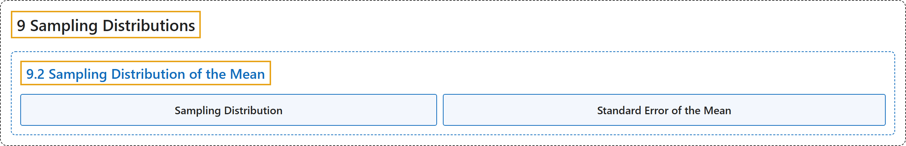

# 9.2 Sampling Distribution of the Mean

## Classification

## Glossary

| Term | Definition | 中文翻译 | Source |
|---|---|---|---|
| **9.2 Sampling Distribution of the Mean** 均值的抽样分布 | (No definition) | （无定义） | [Online Statistics Education, n.d., section 9.2](https://onlinestatbook.com/2/sampling_distributions/samp_dist_mean.html) |
| **Sampling Distribution** 抽样分布 | "A **sampling distribution** can be thought of as **a relative frequency distribution with a very large number of samples**. More precisely, a relative frequency distribution approaches the sampling distribution as the number of samples approaches infinity. When a variable is discrete, the heights of the distribution are probabilities. When a variable is continuous, the class intervals have no width and and the heights of the distribution are probability densities." | **抽样分布**可以看作**样本数量非常大的相对频数分布**。更准确地说，当样本数量趋于无穷时，相对频数分布趋近于抽样分布。当变量是离散的时，分布的高度是概率。当变量是连续的时，组距没有宽度，分布的高度是概率密度。 | [Online Statistics Education, n.d., glossary](https://onlinestatbook.com/2/glossary/sampling_distribution.html) |
| **Standard Error of the Mean** 均值的标准误 | "The **standard error of the mean** is the **standard deviation of the sampling distribution of the mean**. The formula for the standard error of the mean in a population is:" | **均值的标准误**是**均值抽样分布的标准差**。总体中均值的标准误的公式为： | [Online Statistics Education, n.d., glossary](https://onlinestatbook.com/2/glossary/sem.html) |

## References

*Online statistics education: An interactive multimedia course of study*. (n.d.). Rice University, University of Houston Clear Lake, and Tufts University. Retrieved October 29, 2026, from <https://onlinestatbook.com/2/>
