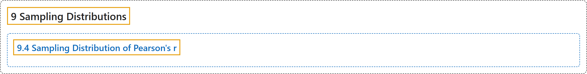

# 9.4 Sampling Distribution of Pearson's r

## Classification

## Glossary

| Term | Definition | 中文翻译 | Source |
|---|---|---|---|
| **9.4 Sampling Distribution of Pearson's r** 皮尔逊相关系数 r 的抽样分布 | (No definition) | （无定义） | [Online Statistics Education, n.d., section 9.4](https://onlinestatbook.com/2/sampling_distributions/samp_dist_r.html) |

## References

*Online statistics education: An interactive multimedia course of study*. (n.d.). Rice University, University of Houston Clear Lake, and Tufts University. Retrieved October 29, 2026, from <https://onlinestatbook.com/2/>
