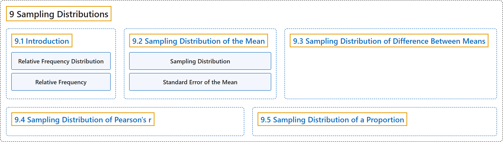

# 9 Sampling Distributions

## Classification

## Glossary

| Term | Definition | 中文翻译 | Source |
|---|---|---|---|
| **9 Sampling Distributions** 抽样分布 | (No definition) | （无定义） | [Online Statistics Education, n.d., chapter 9](https://onlinestatbook.com/2/sampling_distributions/sampling_distributions.html) |
| **[9.1 Introduction](9-1-introduction.md)** 介绍 | (No definition) | （无定义） | [Online Statistics Education, n.d., section 9.1](https://onlinestatbook.com/2/sampling_distributions/intro_samp_dist.html) |
| **[9.2 Sampling Distribution of the Mean](9-2-sampling-distribution-of-the-mean.md)** 均值的抽样分布 | (No definition) | （无定义） | [Online Statistics Education, n.d., section 9.2](https://onlinestatbook.com/2/sampling_distributions/samp_dist_mean.html) |
| **[9.3 Sampling Distribution of Difference Between Means](9-3-sampling-distribution-of-difference-between-means.md)** 均值之差的抽样分布 | (No definition) | （无定义） | [Online Statistics Education, n.d., section 9.3](https://onlinestatbook.com/2/sampling_distributions/samplingdist_diff_means.html) |
| **[9.4 Sampling Distribution of Pearson's r](9-4-sampling-distribution-of-pearson-s-r.md)** 皮尔逊相关系数 r 的抽样分布 | (No definition) | （无定义） | [Online Statistics Education, n.d., section 9.4](https://onlinestatbook.com/2/sampling_distributions/samp_dist_r.html) |
| **[9.5 Sampling Distribution of a Proportion](9-5-sampling-distribution-of-a-proportion.md)** 比例的抽样分布 | (No definition) | （无定义） | [Online Statistics Education, n.d., section 9.5](https://onlinestatbook.com/2/sampling_distributions/samp_dist_p.html) |

## References

*Online statistics education: An interactive multimedia course of study*. (n.d.). Rice University, University of Houston Clear Lake, and Tufts University. Retrieved October 29, 2026, from <https://onlinestatbook.com/2/>
