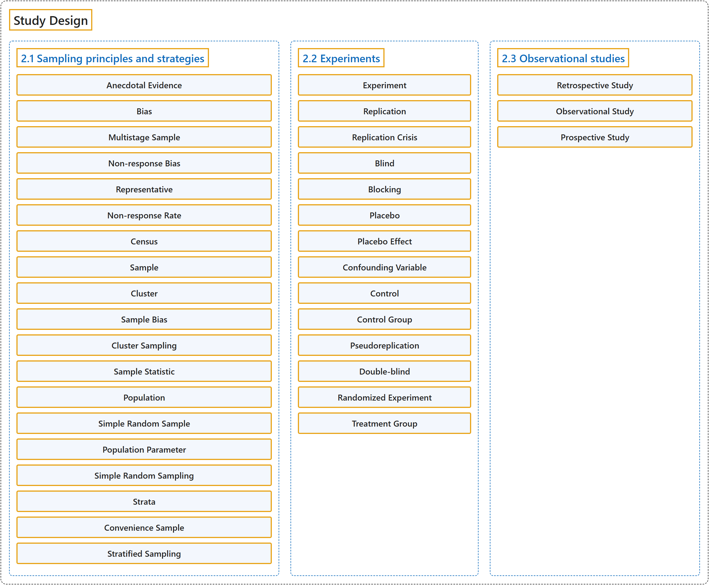

# 2 Study Design

## Classification

## Glossary

| Term | Definition | 中文翻译 | Source |
|---|---|---|---|
| **2 Study Design** 研究设计 | (No definition) | （无定义） | [Çetinkaya-Rundel & Hardin, 2024, chapter 2](https://openintro-ims.netlify.app/data-design.html) |
| **2.1 Sampling principles and strategies** 抽样原则与策略 | (No definition) | （无定义） | [Çetinkaya-Rundel & Hardin, 2024, section 2.1](https://openintro-ims.netlify.app/data-design.html#sec-sampling-principles-strategies) |
| **Anecdotal Evidence** 轶事证据 | "Data collected in this haphazard fashion are called **anecdotal evidence**." | 以这种随意方式收集的数据称为**轶事证据**。 | [Çetinkaya-Rundel & Hardin, 2024, section 2.1](https://openintro-ims.netlify.app/data-design.html#:~:text=Data%20collected%20in%20this%20haphazard%20fashion) |
| **Bias** 偏倚 | "This introduces **bias** into a sample." | 这就给样本引入了**偏倚**。 | [Çetinkaya-Rundel & Hardin, 2024, section 2.1](https://openintro-ims.netlify.app/data-design.html#:~:text=This%20introduces%20bias%20into%20a%20sample.) |
| **Multistage Sample** 多阶段样本 | "A **multistage sample** is like a cluster sample, but rather than keeping all observations in each cluster, we would collect a random sample within each selected cluster." | **多阶段样本**类似于整群样本，但不是保留每个群中的所有观测，而是在每个被选中的群内再收集一个随机样本。 | [Çetinkaya-Rundel & Hardin, 2024, section 2.1](https://openintro-ims.netlify.app/data-design.html#:~:text=A%20multistage%20sample%20is%20like%20a) |
| **Non-response Bias** 无应答偏倚 | "For instance, if only 30% of the people randomly sampled for a survey actually respond, then it is unclear whether the results are representative of the entire population. This **non-response bias** can skew results." | 例如，如果被随机抽中参加调查的人中只有 30% 实际作答，那么就不清楚结果是否能代表整个总体。这种**无应答偏倚**会使结果产生偏差。 | [Çetinkaya-Rundel & Hardin, 2024, section 2.1](https://openintro-ims.netlify.app/data-design.html#:~:text=For%20instance%2C%20if%20only%2030%25%20of) |
| **Representative** 代表性 | "For instance, if only 30% of the people randomly sampled for a survey actually respond, then it is unclear whether the results are **representative** of the entire population." | 例如，如果被随机抽中参加调查的人中只有 30% 实际作答，那么就不清楚结果是否能**代表**整个总体。 | [Çetinkaya-Rundel & Hardin, 2024, section 2.1](https://openintro-ims.netlify.app/data-design.html#:~:text=For%20instance%2C%20if%20only%2030%25%20of) |
| **Non-response Rate** 无应答率 | "Even when people are picked at random, e.g., for surveys, caution must be exercised if the **non-response rate** is high." | 即使人们是被随机抽中的（例如在调查中），如果**无应答率**很高，也必须谨慎。 | [Çetinkaya-Rundel & Hardin, 2024, section 2.1](https://openintro-ims.netlify.app/data-design.html#:~:text=Even%20when%20people%20are%20picked%20at) |
| **Census** 普查 | "Collecting data for an entire population is called a **census**." | 收集整个总体的数据称为**普查**。 | [Çetinkaya-Rundel & Hardin, 2024, section 2.1](https://openintro-ims.netlify.app/data-design.html#:~:text=Collecting%20data%20for%20an%20entire%20population) |
| **Sample** 样本 | "A **sample** is the data you have. Ideally, a sample is a small fraction of the population." | **样本**就是你手头的数据。理想情况下，样本是总体的一小部分。 | [Çetinkaya-Rundel & Hardin, 2024, section 2.1](https://openintro-ims.netlify.app/data-design.html#:~:text=A%20sample%20is%20the%20data%20you) |
| **Cluster** 整群 | "In a **cluster sample**, we break up the population into many groups, called **clusters**. Then we sample a fixed number of clusters and include all observations from each of those clusters in the sample." | 在**整群样本**中，我们把总体分成许多组，称为**群**。然后抽取固定数量的群，并把这些群中的所有观测都纳入样本。 | [Çetinkaya-Rundel & Hardin, 2024, section 2.1](https://openintro-ims.netlify.app/data-design.html#:~:text=In%20a%20cluster%20sample%2C%20we%20break) |
| **Sample Bias** 样本偏倚 | "When selecting samples by hand, we run the risk of picking a **biased sample**, even if our bias is unintended." | 手工挑选样本时，即使我们的偏倚是无意的，也有可能选出**有偏样本**。 | [Çetinkaya-Rundel & Hardin, 2024, section 2.1](https://openintro-ims.netlify.app/data-design.html#:~:text=When%20selecting%20samples%20by%20hand%2C%20we) |
| **Cluster Sampling** 整群抽样 | "In the top panel, **cluster sampling** was used: data were binned into nine clusters, three of these clusters were sampled, and all observations within these three clusters were included in the sample." | 在上图中使用了**整群抽样**：数据被分为九个群，抽取其中三个群，这三个群内的所有观测都纳入样本。 | [Çetinkaya-Rundel & Hardin, 2024, section 2.1](https://openintro-ims.netlify.app/data-design.html#:~:text=In%20the%20top%20panel%2C%20cluster%20sampling) |
| **Sample Statistic** 样本统计量 | "We use specific terms in order to differentiate when a number is being calculated on a sample of data (**sample statistic**) and when it is being calculated or considered for calculation on the entire population (population parameter)." | 我们使用专门的术语来区分：数字是基于样本数据计算的（**样本统计量**），还是针对整个总体计算或考虑计算的（总体参数）。 | [Çetinkaya-Rundel & Hardin, 2024, section 2.1](https://openintro-ims.netlify.app/data-design.html#:~:text=We%20use%20specific%20terms%20in%20order) |
| **Population** 总体 | "Each research question refers to a **target population**. In the first question, the target population is all swordfish in the Atlantic Ocean, and each fish represents a case." | 每个研究问题都指向一个**目标总体**。在第一个问题中，目标总体是大西洋中的所有剑鱼，每条鱼是一个个案。 | [Çetinkaya-Rundel & Hardin, 2024, section 2.1](https://openintro-ims.netlify.app/data-design.html#:~:text=Each%20research%20question%20refers%20to%20a) |
| **Simple Random Sample** 简单随机样本 | "The most basic random sample is called a **simple random sample** and is equivalent to drawing names out of a hat to select cases. This means that each case in the population has an equal chance of being included and the cases in the sample are not related to each other." | 最基本的随机样本称为**简单随机样本**，相当于从帽子里抽签选取个案。这意味着总体中的每个个案被纳入样本的机会相等，且样本中的个案彼此无关。 | [Çetinkaya-Rundel & Hardin, 2024, section 2.1](https://openintro-ims.netlify.app/data-design.html#:~:text=The%20most%20basic%20random%20sample%20is) |
| **Population Parameter** 总体参数 | "We use specific terms in order to differentiate when a number is being calculated on a sample of data (sample statistic) and when it is being calculated or considered for calculation on the entire population (**population parameter**)." | 我们使用专门的术语来区分：数字是基于样本数据计算的（样本统计量），还是针对整个总体计算或考虑计算的（**总体参数**）。 | [Çetinkaya-Rundel & Hardin, 2024, section 2.1](https://openintro-ims.netlify.app/data-design.html#:~:text=We%20use%20specific%20terms%20in%20order) |
| **Simple Random Sampling** 简单随机抽样 | "In general, a sample is referred to as “**simple random**” if each case in the population has an equal chance of being included in the final sample and knowing that a case is included in a sample does not provide useful information about which other cases are included." | 一般而言，如果总体中的每个个案被纳入最终样本的机会相等，并且知道某个个案被纳入样本并不能提供关于其他哪些个案被纳入的有用信息，则称样本为“**简单随机**”的。 | [Çetinkaya-Rundel & Hardin, 2024, section 2.1](https://openintro-ims.netlify.app/data-design.html#:~:text=In%20general%2C%20a%20sample%20is%20referred) |
| **Strata** 层 | "The population is divided into groups called **strata**. The strata are chosen so that similar cases are grouped together, then a second sampling method, usually simple random sampling, is employed within each stratum." | 总体被分成若干组，称为**层**。分层时要使相似的个案归入同一层，然后在每一层内采用第二种抽样方法（通常是简单随机抽样）。 | [Çetinkaya-Rundel & Hardin, 2024, section 2.1](https://openintro-ims.netlify.app/data-design.html#:~:text=The%20population%20is%20divided%20into%20groups) |
| **Convenience Sample** 便利样本 | "Another common downfall is a **convenience sample**, where individuals who are easily accessible are more likely to be included in the sample." | 另一个常见的缺陷是**便利样本**，即容易接触到的个体更有可能被纳入样本。 | [Çetinkaya-Rundel & Hardin, 2024, section 2.1](https://openintro-ims.netlify.app/data-design.html#:~:text=Another%20common%20downfall%20is%20a%20convenience) |
| **Stratified Sampling** 分层抽样 | "**Stratified sampling** is a divide-and-conquer sampling strategy. The population is divided into groups called **strata**. The strata are chosen so that similar cases are grouped together, then a second sampling method, usually simple random sampling, is employed within each stratum." | **分层抽样**是一种分而治之的抽样策略。总体被分成若干组，称为**层**。分层时要使相似的个案归入同一层，然后在每一层内采用第二种抽样方法（通常是简单随机抽样）。 | [Çetinkaya-Rundel & Hardin, 2024, section 2.1](https://openintro-ims.netlify.app/data-design.html#:~:text=Stratified%20sampling%20is%20a%20divide-and-conquer%20sampling) |
| **2.2 Experiments** 实验 | (No definition) | （无定义） | [Çetinkaya-Rundel & Hardin, 2024, section 2.2](https://openintro-ims.netlify.app/data-design.html#sec-experiments) |
| **Experiment** 实验 | "Studies where the researchers assign treatments to cases are called **experiments**." | 研究者向个案分配处理的研究称为**实验**。 | [Çetinkaya-Rundel & Hardin, 2024, section 2.2](https://openintro-ims.netlify.app/data-design.html#:~:text=Studies%20where%20the%20researchers%20assign%20treatments) |
| **Replication** 重复 | "The more cases researchers observe, the more accurately they can estimate the effect of the explanatory variable on the response. In a single study, we **replicate** by collecting a sufficiently large sample." | 研究者观察的个案越多，就越能准确地估计解释变量对响应的效应。在单项研究中，我们通过收集足够大的样本来进行**重复**。 | [Çetinkaya-Rundel & Hardin, 2024, section 2.2](https://openintro-ims.netlify.app/data-design.html#:~:text=The%20more%20cases%20researchers%20observe%2C%20the) |
| **Replication Crisis** 重复性危机 | "The term **replication crisis** refers to the ongoing methodological crisis in which past findings from scientific studies in several disciplines have failed to be replicated." | **重复性危机**一词指目前持续存在的方法论危机，即多个学科过去的科学研究发现未能被重复验证。 | [Çetinkaya-Rundel & Hardin, 2024, section 2.2](https://openintro-ims.netlify.app/data-design.html#:~:text=The%20term%20replication%20crisis%20refers%20to) |
| **Blind** 盲法 | "When researchers keep the patients uninformed about their treatment, the study is said to be **blind**." | 当研究者不让患者知道自己接受的处理时，该研究称为**盲**研究。 | [Çetinkaya-Rundel & Hardin, 2024, section 2.2](https://openintro-ims.netlify.app/data-design.html#:~:text=When%20researchers%20keep%20the%20patients%20uninformed) |
| **Blocking** 区组化 | "Under these circumstances, they may first group individuals based on this variable into **blocks** and then randomize cases within each block to the treatment groups. This strategy is often referred to as **blocking**." | 在这种情况下，他们可以先根据该变量把个体分成若干**区组**，然后在每个区组内把个案随机分配到各处理组。这种策略常称为**区组化**。 | [Çetinkaya-Rundel & Hardin, 2024, section 2.2](https://openintro-ims.netlify.app/data-design.html#:~:text=Under%20these%20circumstances%2C%20they%20may%20first) |
| **Placebo** 安慰剂 | "A solution to this problem is to give a fake treatment to patients in the control group. This is called a **placebo**, and an effective placebo is the key to making a study truly blind." | 解决这个问题的办法是给对照组患者一种假处理。这称为**安慰剂**，有效的安慰剂是使研究真正成为盲研究的关键。 | [Çetinkaya-Rundel & Hardin, 2024, section 2.2](https://openintro-ims.netlify.app/data-design.html#:~:text=A%20solution%20to%20this%20problem%20is) |
| **Placebo Effect** 安慰剂效应 | "Oftentimes, a placebo results in a slight but real improvement in patients. This effect has been dubbed the **placebo effect**." | 安慰剂往往会使患者出现轻微但真实的改善。这种效应被称为**安慰剂效应**。 | [Çetinkaya-Rundel & Hardin, 2024, section 2.2](https://openintro-ims.netlify.app/data-design.html#:~:text=Oftentimes%2C%20a%20placebo%20results%20in%20a) |
| **Confounding Variable** 混杂变量 | "In this example dietary habit is a **confounding variable** 4, which is defined as a variable that is associated with both the explanatory and response variables." | 在这个例子中，饮食习惯是一个**混杂变量** 4，其定义为与解释变量和响应变量都相关联的变量。 | [Çetinkaya-Rundel & Hardin, 2024, section 2.2](https://openintro-ims.netlify.app/data-design.html#:~:text=In%20this%20example%20dietary%20habit%20is) |
| **Control** 控制 | "Researchers assign treatments to cases, and they do their best to **control** any other differences in the groups" | 研究者向个案分配处理，并尽力**控制**各组之间的其他差异 | [Çetinkaya-Rundel & Hardin, 2024, section 2.2](https://openintro-ims.netlify.app/data-design.html#:~:text=Researchers%20assign%20treatments%20to%20cases%2C%20and) |
| **Control Group** 对照组 | "The other group, called the **control group**, did not receive any drug treatment." | 另一组称为**对照组**，不接受任何药物处理。 | [Çetinkaya-Rundel & Hardin, 2024, section 2.2](https://openintro-ims.netlify.app/data-design.html#:~:text=The%20other%20group%2C%20called%20the%20control) |
| **Pseudoreplication** 伪重复 | "**Pseudoreplication** occurs when individual observations under different treatments are heavily dependent on each other." | 当不同处理下的个体观测彼此高度依赖时，就会出现**伪重复**。 | [Çetinkaya-Rundel & Hardin, 2024, section 2.2](https://openintro-ims.netlify.app/data-design.html#:~:text=Pseudoreplication%20occurs%20when%20individual%20observations%20under) |
| **Double-blind** 双盲 | "To guard against this bias, which again has been found to have a measurable effect in some instances, most modern studies employ a **double-blind** setup where doctors or researchers who interact with patients are, just like the patients, unaware of who is or is not receiving the treatment." | 为防范这种偏倚（在某些情况下已发现它有可测量的影响），大多数现代研究采用**双盲**设置，即与患者接触的医生或研究者和患者一样，不知道谁接受了处理、谁没有。 | [Çetinkaya-Rundel & Hardin, 2024, section 2.2](https://openintro-ims.netlify.app/data-design.html#:~:text=To%20guard%20against%20this%20bias%2C%20which) |
| **Randomized Experiment** 随机化实验 | "When this assignment includes randomization, e.g., using a coin flip to decide which treatment a patient receives, it is called a **randomized experiment**." | 当这种分配包含随机化时（例如用抛硬币来决定患者接受哪种处理），就称为**随机化实验**。 | [Çetinkaya-Rundel & Hardin, 2024, section 2.2](https://openintro-ims.netlify.app/data-design.html#:~:text=When%20this%20assignment%20includes%20randomization%2C%20e.g.%2C) |
| **Treatment Group** 处理组 | "One group, the **treatment group**, received the drug." | 一组称为**处理组**，接受药物。 | [Çetinkaya-Rundel & Hardin, 2024, section 2.2](https://openintro-ims.netlify.app/data-design.html#:~:text=One%20group%2C%20the%20treatment%20group%2C%20received) |
| **2.3 Observational studies** 观察性研究 | (No definition) | （无定义） | [Çetinkaya-Rundel & Hardin, 2024, section 2.3](https://openintro-ims.netlify.app/data-design.html#sec-observational-studies) |
| **Retrospective Study** 回顾性研究 | "**Retrospective studies** collect data after events have taken place, e.g., researchers may review past events in medical records." | **回顾性研究**在事件发生之后收集数据，例如研究者可以查阅医疗记录中的既往事件。 | [Çetinkaya-Rundel & Hardin, 2024, section 2.3](https://openintro-ims.netlify.app/data-design.html#:~:text=Retrospective%20studies%20collect%20data%20after%20events) |
| **Observational Study** 观察性研究 | "Studies where no treatment has been explicitly applied (or explicitly withheld) are called **observational studies**." | 没有明确施加（或明确不施加）任何处理的研究称为**观察性研究**。 | [Çetinkaya-Rundel & Hardin, 2024, section 2.3](https://openintro-ims.netlify.app/data-design.html#:~:text=Studies%20where%20no%20treatment%20has%20been) |
| **Prospective Study** 前瞻性研究 | "A **prospective study** identifies individuals and collects information as events unfold." | **前瞻性研究**先确定个体，并随着事件的发展收集信息。 | [Çetinkaya-Rundel & Hardin, 2024, section 2.3](https://openintro-ims.netlify.app/data-design.html#:~:text=A%20prospective%20study%20identifies%20individuals%20and) |

## References

Çetinkaya-Rundel, M., & Hardin, J. (2024). *Introduction to modern statistics* (2nd ed.). OpenIntro. Retrieved October 28, 2026, from <https://openintro-ims.netlify.app/>
