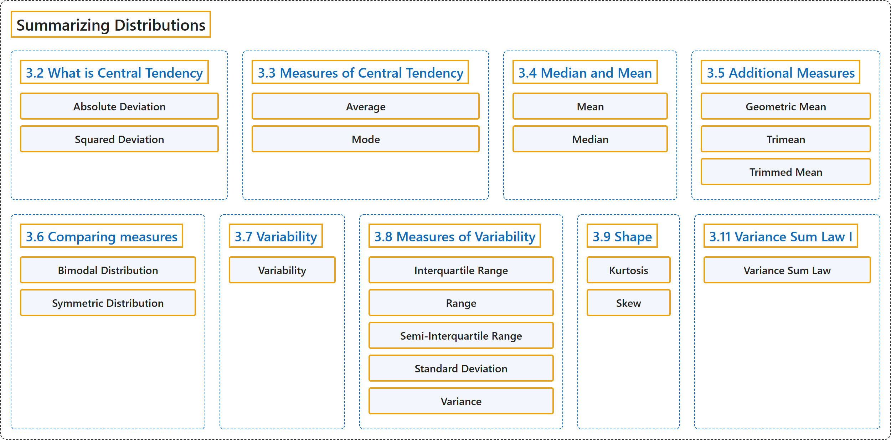

# 3 Summarizing Distributions

## Classification

## Glossary

| Term | Definition | 中文翻译 | Source |
|---|---|---|---|
| **3 Summarizing Distributions** 分布的概括 | (No definition) | （无定义） | [Online Statistics Education, n.d., chapter 3](https://onlinestatbook.com/2/summarizing_distributions/summarizing_distributions.html) |
| **3.2 What is Central Tendency** 什么是集中趋势 | (No definition) | （无定义） | [Online Statistics Education, n.d., section 3.2](https://onlinestatbook.com/2/summarizing_distributions/what_is_ct.html) |
| **Absolute Deviation** 绝对偏差 | "The **absolute value of the difference between two numbers**. The absolute deviation between 5 and 3 is 2; between 3 and 5 is 2; and between -4 and 2 it is 6." | **两个数之差的绝对值**。5 与 3 之间的绝对偏差为 2；3 与 5 之间为 2；-4 与 2 之间为 6。 | [Online Statistics Education, n.d., glossary](https://onlinestatbook.com/2/glossary/absolute_deviation.html) |
| **Squared Deviation** 平方偏差 | "A **squared deviation** is the **difference between two values, squared**. The number that minimizes the sum of squared deviations for a variable is its mean." | **平方偏差**是**两个值之差的平方**。使变量的平方偏差之和最小的数是它的均值。 | [Online Statistics Education, n.d., glossary](https://onlinestatbook.com/2/glossary/squared_deviation.html) |
| **3.3 Measures of Central Tendency** 集中趋势的度量 | (No definition) | （无定义） | [Online Statistics Education, n.d., section 3.3](https://onlinestatbook.com/2/summarizing_distributions/measures.html) |
| **Average** 平均数 | "(i) The **(arithmetic) mean**" | （i）（算术）**平均数** | [Online Statistics Education, n.d., glossary](https://onlinestatbook.com/2/glossary/average.html) |
| **Mode** 众数 | "The **mode** is a measure of central tendency. It is **the most frequent value in a distribution** : the mode of 3, 4, 4, 5, 5, 5, 8 is 5. Note that the mode may be very different from the mean and the median." | **众数**是集中趋势的一种度量。它是**分布中出现次数最多的值** ：3、4、4、5、5、5、8 的众数是 5。注意，众数可能与均值和中位数相差很大。 | [Online Statistics Education, n.d., glossary](https://onlinestatbook.com/2/glossary/mode.html) |
| **3.4 Median and Mean** 中位数与均值 | (No definition) | （无定义） | [Online Statistics Education, n.d., section 3.4](https://onlinestatbook.com/2/summarizing_distributions/mean_median_def.html) |
| **Mean** 均值 | "Also known as the arithmetic mean, the **mean** is typically what is meant by the word “ average.” The mean is perhaps the most common measure of central tendency. The mean of a variable is given by (the sum of all its values)/(the number of values). For example, the mean of 4, 8, and 9 is 7. The sample mean is written as $M$, and the population mean as the Greek letter mu ($\mu$). Despite its popularity, the mean may not be an appropriate measure of central tendency for skewed distributions, or in situations with outliers." | **均值**也称算术平均数，通常就是“平均数”一词所指的含义。均值也许是最常用的集中趋势度量。变量的均值由（其所有值之和）/（值的个数）给出。例如，4、8 和 9 的均值是 7。样本均值记为 $M$，总体均值记为希腊字母 mu（$\mu$）。尽管均值很常用，但对于偏态分布或存在离群值的情形，它可能不是合适的集中趋势度量。 | [Online Statistics Education, n.d., glossary](https://onlinestatbook.com/2/glossary/mean.html) |
| **Median** 中位数 | "The **median** is a popular measure of central tendency. It is **the 50th percentile of a distribution**. To find the median of a number of values, first order them, then find the observation in the middle: the median of 5, 2, 7, 9, and 4 is 5. (Note that if there is an even number of values, one takes the average of the middle two: the median of 4, 6, 8, and 10 is 7.) The median is often more appropriate than the mean in skewed distributions and in situations with outliers." | **中位数**是一种常用的集中趋势度量。它是**分布的第 50 百分位数**。要求若干个值的中位数，先将它们排序，再找出位于中间的观测值：5、2、7、9 和 4 的中位数是 5。（注意，如果值的个数为偶数，则取中间两个值的平均数：4、6、8 和 10 的中位数是 7。）在偏态分布和存在离群值的情形中，中位数往往比均值更合适。 | [Online Statistics Education, n.d., glossary](https://onlinestatbook.com/2/glossary/median.html) |
| **3.5 Additional Measures** 其他度量 | (No definition) | （无定义） | [Online Statistics Education, n.d., section 3.5](https://onlinestatbook.com/2/summarizing_distributions/additional_measures.html) |
| **Geometric Mean** 几何平均数 | "The **geometric mean** is a measure of central tendency. The geometric mean of $n$ numbers is obtained by **multiplying all of them together, and then taking the nth root of them**. For example, for the numbers 1, 10, and 100, the product of all the numbers is: $1 \times 10 \times 100 = 1,000$. Since there are three numbers, we take the cubed root of the product (1,000) which is equal to 10." | **几何平均数**是集中趋势的一种度量。$n$ 个数的几何平均数是**将它们全部相乘，然后取其 n 次方根**得到的。例如，对于数 1、10 和 100，所有数的乘积为：$1 \times 10 \times 100 = 1,000$。由于有三个数，我们取乘积（1,000）的立方根，结果等于 10。 | [Online Statistics Education, n.d., glossary](https://onlinestatbook.com/2/glossary/geometric_mean.html) |
| **Trimean** 三均值 | "The **trimean** is a robust measure of central tendency ; it is a **weighted average of the 25th, 50th, and 75th percentiles**. Specifically it is computed as follows:" | **三均值**是集中趋势的稳健度量；它是**第 25、第 50 和第 75 百分位数的加权平均数**。具体计算如下： | [Online Statistics Education, n.d., glossary](https://onlinestatbook.com/2/glossary/trimean.html) |
| **Trimmed Mean** 截尾均值 | "The **trimmed mean** is a robust measure of central tendency generally falling between the mean and the median. As in the computation of the median, all observations are ordered. Next, **the highest and lowest $\alpha$ percent of the data are removed**, where $\alpha$ ranges from 0 to 50. Finally, the mean of the remaining observations is taken. The trimmed mean has advantages over both the mean and median, but is analytically more intractable." | **截尾均值**是一种稳健的集中趋势度量，通常介于均值与中位数之间。与计算中位数时一样，先将所有观测值排序。接着，**去掉数据中最高和最低的 $\alpha$ 百分比**，其中 $\alpha$ 的取值范围为 0 到 50。最后，取其余观测值的均值。截尾均值相对于均值和中位数都有优势，但在分析上更难处理。 | [Online Statistics Education, n.d., glossary](https://onlinestatbook.com/2/glossary/trimmed_mean.html) |
| **3.6 Comparing measures** 度量的比较 | (No definition) | （无定义） | [Online Statistics Education, n.d., section 3.6](https://onlinestatbook.com/2/summarizing_distributions/comparing_measures.html) |
| **Bimodal Distribution** 双峰分布 | "A **distribution with two distinct peaks**. An example is shown below." | 具有两个明显峰值的**分布**。示例如下。 | [Online Statistics Education, n.d., glossary](https://onlinestatbook.com/2/glossary/Bimodal_Distribution.html) |
| **Symmetric Distribution** 对称分布 | "In a **symmetric distribution**, the upper and lower halves of the distribution are mirror images of each other. For example, in the distribution shown below, the portions above and below 50 are mirror images of each other. In a symmetric distribution, the mean is equal to the median. Antonym: skewed distribution." | 在**对称分布**中，分布的上半部分和下半部分互为镜像。例如，在下面所示的分布中，50 以上和 50 以下的部分互为镜像。在对称分布中，均值等于中位数。反义词：偏态分布。 | [Online Statistics Education, n.d., glossary](https://onlinestatbook.com/2/glossary/symmetric_distribution.html) |
| **3.7 Variability** 变异性 | (No definition) | （无定义） | [Online Statistics Education, n.d., section 3.7](https://onlinestatbook.com/2/summarizing_distributions/variability_ov.html) |
| **Variability** 变异性 | "**Variability** refers to **the extent to which values differ from one another**. That is, how much they vary. Variability can also be thought of as how spread out a distribution is. The standard deviation and the semi-interquartile range are measures of variability." | **变异性**指**各值彼此相异的程度**。也就是说，它们变化有多大。变异性也可以看作分布的分散程度。标准差和半四分位距是变异性的度量。 | [Online Statistics Education, n.d., glossary](https://onlinestatbook.com/2/glossary/variability.html) |
| **3.8 Measures of Variability** 变异性的度量 | (No definition) | （无定义） | [Online Statistics Education, n.d., section 3.8](https://onlinestatbook.com/2/summarizing_distributions/variability.html) |
| **Interquartile Range** 四分位距 | "The **Interquartile Range** (IQR) is the (75th percentile – 25th percentile). It is a robust measure of variability." | **四分位距**（IQR）是（第 75 百分位数 – 第 25 百分位数）。它是变异性的稳健度量。 | [Online Statistics Education, n.d., glossary](https://onlinestatbook.com/2/glossary/interquartile_range.html) |
| **Range** 极差 | "The **difference between the maximum and minimum values** of a variable or distribution. The range is the simplest measure of variability." | 变量或分布的**最大值与最小值之差**。极差是最简单的变异性度量。 | [Online Statistics Education, n.d., glossary](https://onlinestatbook.com/2/glossary/range.html) |
| **Semi-Interquartile Range** 半四分位距 | "The **semi interquartile range** is the **interquartile range divided by 2**. It is a robust measure of variability. The Interquartile Range is the (75th percentile – 25th percentile)." | **半四分位距**是**四分位距除以 2**。它是变异性的一种稳健度量。四分位距是（第 75 百分位数 – 第 25 百分位数）。 | [Online Statistics Education, n.d., glossary](https://onlinestatbook.com/2/glossary/semi-interquartile_range.html) |
| **Standard Deviation** 标准差 | "The **standard deviation** is a widely used measure of variability. It is computed by taking the square root of the variance. An important attribute of the standard deviation as a measure of variability is that if the mean and standard deviation of a normal distribution are known, it is possible to compute the percentile rank associated with any given score." | **标准差**是一种广泛使用的变异性度量。它通过对方差取平方根计算得到。标准差作为变异性度量的一个重要特性是：如果已知正态分布的均值和标准差，就可以计算与任一给定得分相对应的百分位等级。 | [Online Statistics Education, n.d., glossary](https://onlinestatbook.com/2/glossary/standard_deviation.html) |
| **Variance** 方差 | "The **variance** is a widely used measure of variability. It is defined as **the mean squared deviation of scores from the mean**. The formula for variance computed in an entire population is" | **方差**是一种广泛使用的变异性度量。它被定义为**分数与均值的离差平方的均值**。在整个总体中计算方差的公式为 | [Online Statistics Education, n.d., glossary](https://onlinestatbook.com/2/glossary/variance.html) |
| **3.9 Shape** 形状 | (No definition) | （无定义） | [Online Statistics Education, n.d., section 3.9](https://onlinestatbook.com/2/summarizing_distributions/shapes.html) |
| **Kurtosis** 峰度 | "**Kurtosis** measures how fat or thin the tails of a distribution are relative to a normal distribution. It is commonly defined as:" | **峰度**衡量分布的尾部相对于正态分布是厚还是薄。它通常定义为： | [Online Statistics Education, n.d., glossary](https://onlinestatbook.com/2/glossary/kurtosis.html) |
| **Skew** 偏态 | "A distribution is **skewed** if one tail extends out further than the other. A distribution has positive skew (is skewed to the right) if the tail to the right is longer. See the graph below for an example." | 如果分布的一条尾部比另一条延伸得更远，则该分布是**偏态**的。如果右侧的尾部更长，则分布具有正偏态（向右偏）。示例见下图。 | [Online Statistics Education, n.d., glossary](https://onlinestatbook.com/2/glossary/skew.html) |
| **3.11 Variance Sum Law I** 方差和定律 I | (No definition) | （无定义） | [Online Statistics Education, n.d., section 3.11](https://onlinestatbook.com/2/summarizing_distributions/variance_sum_law.html) |
| **Variance Sum Law** 方差和定律 | "The **variance sum law** is an expression for the variance of the sum of two variables. If the variables are independent and therefore Pearson's $r = 0$, the following formula represents the variance of the sum and difference of the variables $X$ and $Y$: … Note that you add the variances for both $X + Y$ and $X - Y$. If $X$ and $Y$ are correlated, then the follownig formula (which the former is a special case) should be used: … where $\rho$ is the population value of the correlation. In a sample $r$ is used as an estimate of $\rho$." | **方差和定律**是两个变量之和的方差的表达式。如果变量相互独立，因而皮尔逊 $r = 0$，则下面的公式表示变量 $X$ 与 $Y$ 之和与之差的方差：… 注意，对 $X + Y$ 和 $X - Y$ 都是将方差相加。如果 $X$ 与 $Y$ 相关，则应使用下面的公式（前一个公式是它的特例）：… 其中 $\rho$ 是相关的总体值。在样本中，用 $r$ 作为 $\rho$ 的估计。 | [Online Statistics Education, n.d., glossary](https://onlinestatbook.com/2/glossary/variance_sum_law.html) |

## References

*Online statistics education: An interactive multimedia course of study*. (n.d.). Rice University, University of Houston Clear Lake, and Tufts University. Retrieved October 29, 2026, from <https://onlinestatbook.com/2/>
