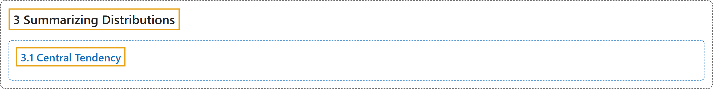

# 3.1 Central Tendency

## Classification

## Glossary

| Term | Definition | 中文翻译 | Source |
|---|---|---|---|
| **3.1 Central Tendency** 集中趋势 | (No definition) | （无定义） | [Online Statistics Education, n.d., section 3.1](https://onlinestatbook.com/2/summarizing_distributions/central_tendency.html) |

## References

*Online statistics education: An interactive multimedia course of study*. (n.d.). Rice University, University of Houston Clear Lake, and Tufts University. Retrieved October 29, 2026, from <https://onlinestatbook.com/2/>
