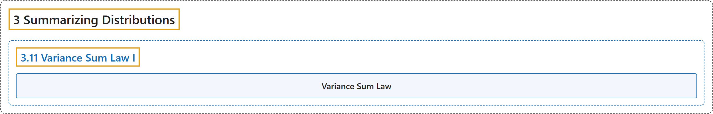

# 3.11 Variance Sum Law I

## Classification

## Glossary

| Term | Definition | 中文翻译 | Source |
|---|---|---|---|
| **3.11 Variance Sum Law I** 方差和定律 I | (No definition) | （无定义） | [Online Statistics Education, n.d., section 3.11](https://onlinestatbook.com/2/summarizing_distributions/variance_sum_law.html) |
| **Variance Sum Law** 方差和定律 | "The **variance sum law** is an expression for the variance of the sum of two variables. If the variables are independent and therefore Pearson's $r = 0$, the following formula represents the variance of the sum and difference of the variables $X$ and $Y$: … Note that you add the variances for both $X + Y$ and $X - Y$. If $X$ and $Y$ are correlated, then the follownig formula (which the former is a special case) should be used: … where $\rho$ is the population value of the correlation. In a sample $r$ is used as an estimate of $\rho$." | **方差和定律**是两个变量之和的方差的表达式。如果变量相互独立，因而皮尔逊 $r = 0$，则下面的公式表示变量 $X$ 与 $Y$ 之和与之差的方差：… 注意，对 $X + Y$ 和 $X - Y$ 都是将方差相加。如果 $X$ 与 $Y$ 相关，则应使用下面的公式（前一个公式是它的特例）：… 其中 $\rho$ 是相关的总体值。在样本中，用 $r$ 作为 $\rho$ 的估计。 | [Online Statistics Education, n.d., glossary](https://onlinestatbook.com/2/glossary/variance_sum_law.html) |

## References

*Online statistics education: An interactive multimedia course of study*. (n.d.). Rice University, University of Houston Clear Lake, and Tufts University. Retrieved October 29, 2026, from <https://onlinestatbook.com/2/>
