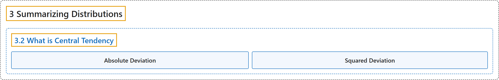

# 3.2 What is Central Tendency

## Classification

## Glossary

| Term | Definition | 中文翻译 | Source |
|---|---|---|---|
| **3.2 What is Central Tendency** 什么是集中趋势 | (No definition) | （无定义） | [Online Statistics Education, n.d., section 3.2](https://onlinestatbook.com/2/summarizing_distributions/what_is_ct.html) |
| **Absolute Deviation** 绝对偏差 | "The **absolute value of the difference between two numbers**. The absolute deviation between 5 and 3 is 2; between 3 and 5 is 2; and between -4 and 2 it is 6." | **两个数之差的绝对值**。5 与 3 之间的绝对偏差为 2；3 与 5 之间为 2；-4 与 2 之间为 6。 | [Online Statistics Education, n.d., glossary](https://onlinestatbook.com/2/glossary/absolute_deviation.html) |
| **Squared Deviation** 平方偏差 | "A **squared deviation** is the **difference between two values, squared**. The number that minimizes the sum of squared deviations for a variable is its mean." | **平方偏差**是**两个值之差的平方**。使变量的平方偏差之和最小的数是它的均值。 | [Online Statistics Education, n.d., glossary](https://onlinestatbook.com/2/glossary/squared_deviation.html) |

## References

*Online statistics education: An interactive multimedia course of study*. (n.d.). Rice University, University of Houston Clear Lake, and Tufts University. Retrieved October 29, 2026, from <https://onlinestatbook.com/2/>
