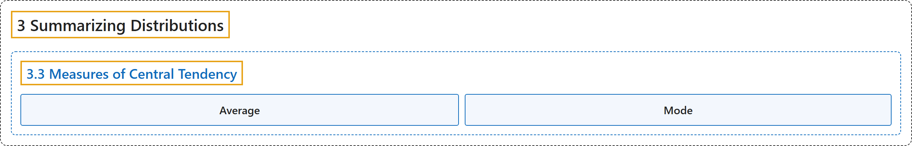

# 3.3 Measures of Central Tendency

## Classification

## Glossary

| Term | Definition | 中文翻译 | Source |
|---|---|---|---|
| **3.3 Measures of Central Tendency** 集中趋势的度量 | (No definition) | （无定义） | [Online Statistics Education, n.d., section 3.3](https://onlinestatbook.com/2/summarizing_distributions/measures.html) |
| **Average** 平均数 | "(i) The **(arithmetic) mean**" | （i）（算术）**平均数** | [Online Statistics Education, n.d., glossary](https://onlinestatbook.com/2/glossary/average.html) |
| **Mode** 众数 | "The **mode** is a measure of central tendency. It is **the most frequent value in a distribution** : the mode of 3, 4, 4, 5, 5, 5, 8 is 5. Note that the mode may be very different from the mean and the median." | **众数**是集中趋势的一种度量。它是**分布中出现次数最多的值** ：3、4、4、5、5、5、8 的众数是 5。注意，众数可能与均值和中位数相差很大。 | [Online Statistics Education, n.d., glossary](https://onlinestatbook.com/2/glossary/mode.html) |

## References

*Online statistics education: An interactive multimedia course of study*. (n.d.). Rice University, University of Houston Clear Lake, and Tufts University. Retrieved October 29, 2026, from <https://onlinestatbook.com/2/>
