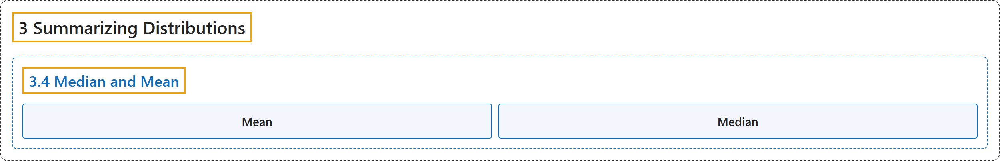

# 3.4 Median and Mean

## Classification

## Glossary

| Term | Definition | 中文翻译 | Source |
|---|---|---|---|
| **3.4 Median and Mean** 中位数与均值 | (No definition) | （无定义） | [Online Statistics Education, n.d., section 3.4](https://onlinestatbook.com/2/summarizing_distributions/mean_median_def.html) |
| **Mean** 均值 | "Also known as the arithmetic mean, the **mean** is typically what is meant by the word “ average.” The mean is perhaps the most common measure of central tendency. The mean of a variable is given by (the sum of all its values)/(the number of values). For example, the mean of 4, 8, and 9 is 7. The sample mean is written as $M$, and the population mean as the Greek letter mu ($\mu$). Despite its popularity, the mean may not be an appropriate measure of central tendency for skewed distributions, or in situations with outliers." | **均值**也称算术平均数，通常就是“平均数”一词所指的含义。均值也许是最常用的集中趋势度量。变量的均值由（其所有值之和）/（值的个数）给出。例如，4、8 和 9 的均值是 7。样本均值记为 $M$，总体均值记为希腊字母 mu（$\mu$）。尽管均值很常用，但对于偏态分布或存在离群值的情形，它可能不是合适的集中趋势度量。 | [Online Statistics Education, n.d., glossary](https://onlinestatbook.com/2/glossary/mean.html) |
| **Median** 中位数 | "The **median** is a popular measure of central tendency. It is **the 50th percentile of a distribution**. To find the median of a number of values, first order them, then find the observation in the middle: the median of 5, 2, 7, 9, and 4 is 5. (Note that if there is an even number of values, one takes the average of the middle two: the median of 4, 6, 8, and 10 is 7.) The median is often more appropriate than the mean in skewed distributions and in situations with outliers." | **中位数**是一种常用的集中趋势度量。它是**分布的第 50 百分位数**。要求若干个值的中位数，先将它们排序，再找出位于中间的观测值：5、2、7、9 和 4 的中位数是 5。（注意，如果值的个数为偶数，则取中间两个值的平均数：4、6、8 和 10 的中位数是 7。）在偏态分布和存在离群值的情形中，中位数往往比均值更合适。 | [Online Statistics Education, n.d., glossary](https://onlinestatbook.com/2/glossary/median.html) |

## References

*Online statistics education: An interactive multimedia course of study*. (n.d.). Rice University, University of Houston Clear Lake, and Tufts University. Retrieved October 29, 2026, from <https://onlinestatbook.com/2/>
